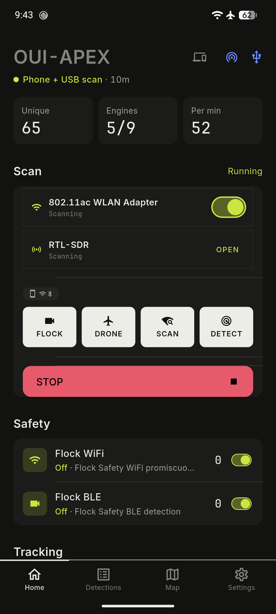
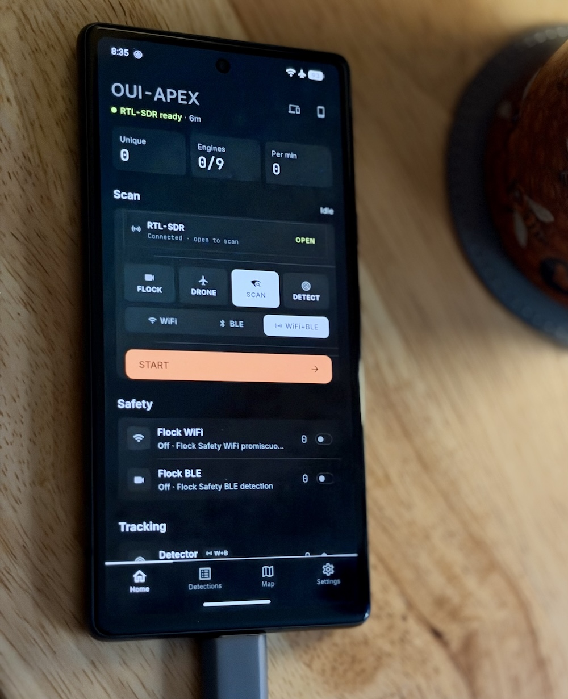
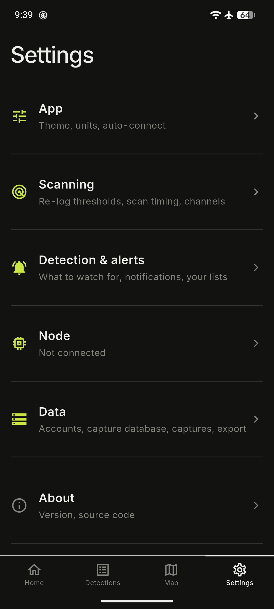
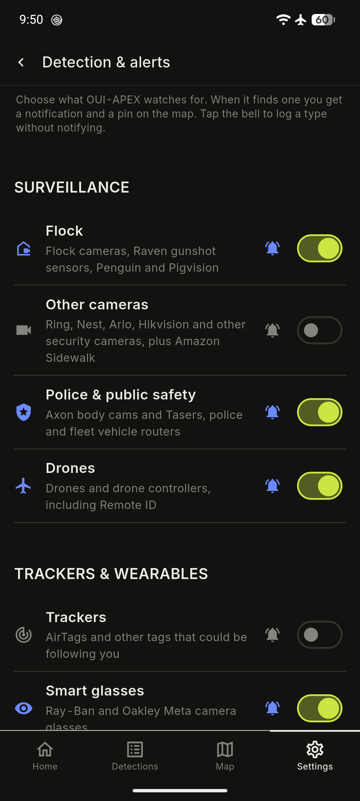
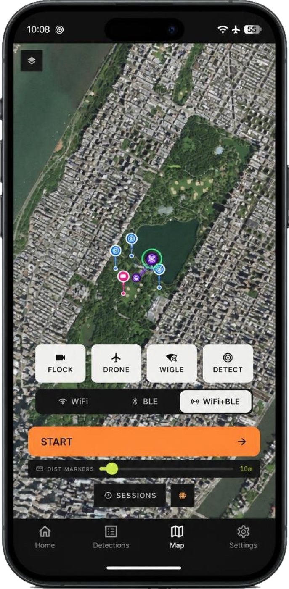
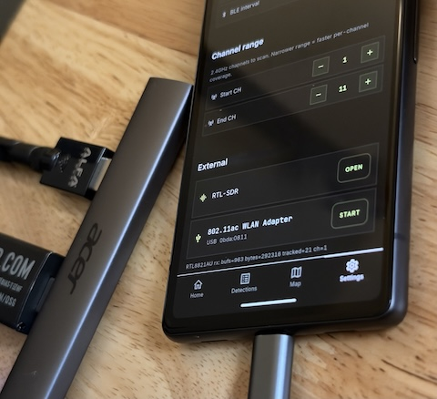
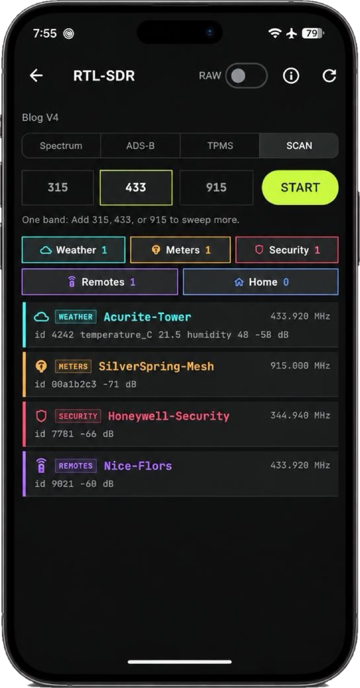
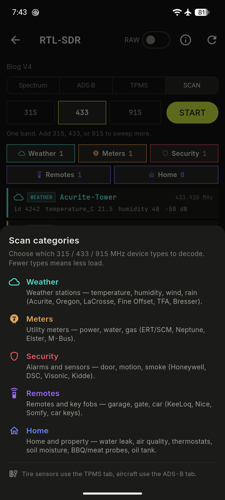
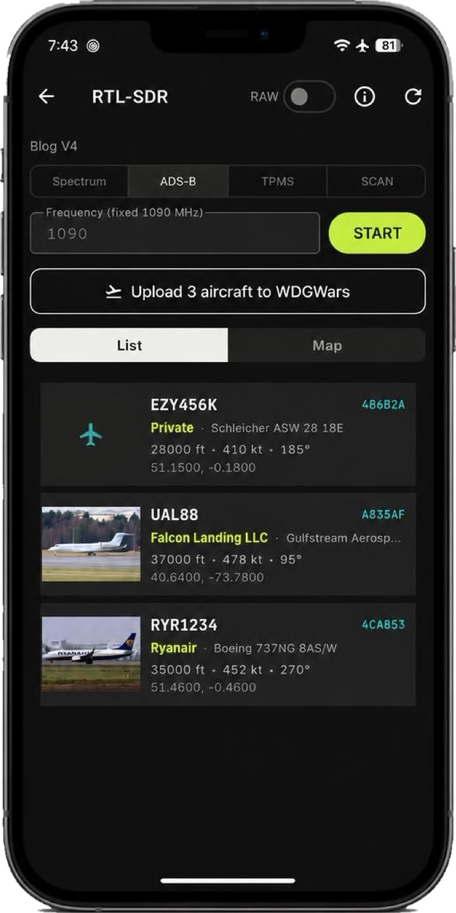
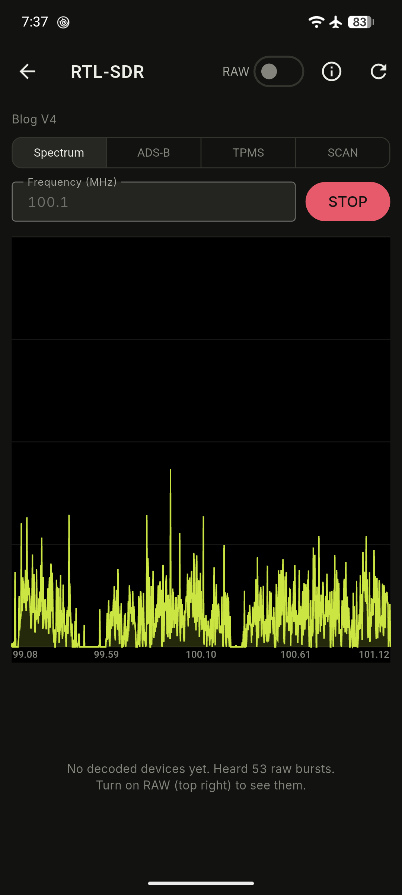

<div align="center">

[](https://github.com/lukeswitz/oui-spy-unified-blue/releases)
[](https://testflight.apple.com/join/5RCKgnJ2)


[](https://github.com/lukeswitz/oui-spy-unified-blue/actions/workflows/github-code-scanning/codeql)

# OUI-APEX

***"Snoop unto them, as they snoop unto us"***

</div>

<div align="center">
<b>OUI-APEX detects surveillance hardware, trackers and drones.</b> It also works as a wardriving and recon tool.
<p>
  
<table>
  <tr>
    <td></td>
    <td></td>
  </tr>
</table>

| Platform | Phone scans | Add-ons |
|---|---|---|
| Android | Bluetooth, Wi-Fi | ESP32 board(s), RTL-SDR, USB Wi-Fi adapter |
| iPhone / macOS | BLE | ESP32 board(s) |

</div>

## Contents

- [Quick start](#quick-start)
- [Engines](#engines)
- [Ways to run](#ways-to-run)
- [App](#app)
- [USB radios on Android](#usb-radios-on-android)
- [Boards](#boards)
- [Standalone controls](#standalone-controls)
- [Mesh](#mesh)
- [Optional GPS module](#optional-gps-module)
- [Privacy](#privacy)
- [Internet services](#internet-services)
- [Build](#build)
- [Credits](#credits)
  

## Quick start

_How it Works:_
- **Firmware (ESP32):** Runs combined OUI-SPY firmware. Add more boards to form an ESP-NOW mesh perimeter (up to 200m apart).
- **App:** controls the firmware, maps detections, and exports or uploads to WiGLE and WDGWars.
- **Phone:** scans by itself (limited), or foxhunts (tracks a signal to its source) while the boards keep detecting.

_Getting Started:_
1. Flash a board from the [web flasher](https://lukeswitz.github.io/oui-spy-unified-blue/) (Chrome or Edge, USB). Pick the **NODE** target for your board. Later updates come from the app.
2. Install the app: [Android / macOS](https://github.com/lukeswitz/oui-spy-unified-blue/releases/latest) or [iOS / macOS TestFlight](https://testflight.apple.com/join/5RCKgnJ2).
3. Open the app, tap **CONNECT**, pick the board.

- **Android:** set Location to **Allow all the time**, or scanning stops when the screen is off.
- **macOS:** Gatekeeper blocks the first launch of the release zip because it is not notarized. [TestFlight](https://testflight.apple.com/join/5RCKgnJ2) builds are.

> [!IMPORTANT]
> **Turn off Android's Wi-Fi scan limit.** Android allows four Wi-Fi scans every two minutes and fails the rest.
>
> 1. **Settings → About phone**: tap **Build number** seven times to turn on Developer options.
> 2. **Settings → System → Developer options → Networking**: turn off **Wi-Fi scan throttling**.
>
> Menu paths vary by phone. USB Wi-Fi adapters are not limited.

## Engines

| Engine | Finds |
|---|---|
| **Detector** | Your watchlist (MAC, OUI prefix, name, 16-bit BLE service UUID), plus built-in signatures, all off by default: Find My / AirTag following you, floods of new tracker tag addresses, Flipper Zero, Wi-Fi deauth floods, floods of join requests at one access point, Wi-Fi beacon floods (one radio faking 15+ networks), directed probes, Pwnagotchi, Meta Ray-Ban / Oakley glasses, Axon / law-enforcement gear, security / doorbell / dash cameras by vendor OUI or camera brand in the network or device name (Ring, Nest, Arlo, Blink, Wyze, Hikvision, Dahua and others), Amazon Sidewalk BLE |
| **Flock BLE / Flock WiFi** | Flock Safety ALPR cameras and Raven gunshot sensors. Optional OUI-only Wi-Fi hits |
| **Sky Spy** | Drones broadcasting FAA Remote ID over BLE and Wi-Fi: ID, position, altitude, speed, pilot position |
| **Foxhunter** | One target device. Beep rate (or the RSSI meter on boards without a buzzer) rises as you get closer |
| **UniPwn** | Unitree robots by BLE name (`Go2_`, `G1_`, `H1_`, …) |
| **Wardrive** | Every Wi-Fi AP and BLE device, GPS-stamped, WiGLE CSV format. 2.4 GHz channels 1–14 by default; C5 boards add 5 GHz including DFS |
| **PCAP** | Raw 802.11 or BLE advertising frames to a Wireshark `.pcap` |

> [!IMPORTANT]
> The Flock OUI list comes from upstream FlockYou and matches Ubiquiti, Espressif and other common consumer parts. Check a hit with your own eyes before reporting it anywhere.

In SETTINGS → **Detection & alerts**, each type can **alert** (notification plus a map pin), **log only** (tap the bell to record it without notifying), or be off. **OUI-based detection is an optional setting.**

### Flock confidence

| Tier | Matched |
|---|---|
| **VERIFIED** | Bare-serial name + XUNTONG `0x09C8` manufacturer ID + TN serial |
| **HIGH** | One strong signal: Raven service UUID, Flock BLE name, or a Flock wildcard probe |
| **SUSPECTED** | A listed OUI only |

DETECTIONS → HISTORY can filter by tier. 

## Ways to run

| Mode | How | What you get |
|---|---|---|
| **App + board** | Phone app connected to an ESP32 board over Bluetooth | The board runs the engines. The app controls it, shows the feed and map, adds phone GPS, and saves PCAPs |
| **Standalone** | No phone; boards with a screen and buttons | Engines started from the buttons. T-Dongles log to microSD; M5Sticks beep and show hits on screen |
| **Mesh node** | Board runs under a MANAGER the phone connects to | The manager collects every node's hits; settings from the app reach all nodes |
| **Phone only** | No board; PHONE SCAN on | Wardrive, classify, alert and foxhunt with the phone's own radios |
| **Phone + USB radios** | Android, no board; plug in an RTL-SDR and/or a USB Wi-Fi adapter | SDR decodes 315 / 433 / 915 MHz and ADS-B. A USB Wi-Fi adapter scans Wi-Fi, and the MT7921AU also scans Bluetooth LE. Both run alongside the phone's radios |

- **Offline scan** (SETTINGS → NODE → HARDWARE): the board keeps scanning without the phone, even after a reboot, and uploads hits on reconnect. A directly connected board with a GPS module fix also wardrives, one row per device every 5 min, up to 1 MB. It stops after 60 s without a fix.
- **Private Bluetooth link:** the board changes its private address at random every 5–15 min. After pairing, it hides its name and refuses unknown phones. The paired phone reconnects on its own, even after a reboot. There is no PIN; accept the prompt on your phone. To pair another phone, restart the board: it accepts one new phone in the 2 min after power-on. After updating an S3, C3 or older ESP32 board, forget it in your phone's Bluetooth settings and pair again.
- **JCMK node hub** (SETTINGS → NODE → JCMK NODE HUB): the board adds Wi-Fi networks from [Piglet](https://github.com/hamspiced/piglet) ESP-NOW nodes to your wardrive. Tap **Start hub**, power on a Piglet, and tap **Pair** under **Nearby nodes**. The hub board leaves the mesh while it runs. The wardrive radio picker can leave out any paired node.

## App

<div align="center">
<table>
  <tr>
    <td align="center" width="33%"><br><sub>Settings</sub></td>
    <td align="center" width="33%"><br><sub>Detection &amp; alerts</sub></td>
    <td align="center" width="34%"><br><sub>Map</sub></td>
  </tr>
</table>
</div>

- **Home**: session bar (targets, radio, START / PAUSE / STOP) and one card per engine. Status bar shows link, GPS fix and node count.
- **Detections**: LIVE (every hit; filter, sort, search, export), DEVICES (classified devices), HISTORY (stored log, CSV export), ALERTS (every alert, newest first). Tap a hit to see what it is and why, and to foxhunt or map it. SHOW ALL maps its whole class.
- **SETTINGS**: APP, SCANNING, RULES (watchlist, signatures, ignore list), ALERTS, NODE (HARDWARE, MESH, FIRMWARE), DATA (ACCOUNTS, PCAPS, EXPORT).
- **Map**: choose targets (WiGLE / Flock / Drone / Detector) and radio (Wi-Fi / BLE / both), then START. Sessions save as WiGLE CSV, upload to [WiGLE](https://wigle.net) and [WDGWars](https://wdgwars.pl), and replay on the map.
  
- **Classification**: each device gets a class (trackers, cameras, public safety & fleet, drones, glasses, hacking tools, routers, home & office, …). Class alerts are on by default. A Samsung SmartTag away from its owner keeps its path when its address changes, so the **WITH YOU** filter still finds it.
- **Phone scan**: phone icon in the status bar, off at launch. iPhone hits skip WiGLE CSV because iOS hides MAC addresses. iOS also strips Apple's manufacturer data, so a nearby iPhone, AirPods or AirTag arrives as a blank advert and shows as *Apple, kind hidden by iOS*. The iPhone app then connects to it for a moment and checks its services (Find My, AirTag, iPhone notification service) to name the kind.
- **Receive only** (SETTINGS → Detection & alerts, top): one switch that stops every scan from transmitting. Each connected board stops Wi-Fi probe requests and Bluetooth scan requests, and a manager passes this to its mesh nodes. The phone makes no connections and no Wi-Fi scan requests. On Android it only hears scans other apps already run, so it finds far fewer devices. On iPhone the phone scan pauses, because iOS always sends scan requests. Tracker ring is off. Boards still advertise so the phone can reach them, and mesh nodes still talk to each other. Turning it off puts each board back to its own setting.
- **Suggested signatures** (DEVICES → More): groups of 3+ unclassified radios that share a name, service, vendor prefix or company. **SAVE** makes one your own signature, with an optional alert on new matches (SETTINGS → Detection & alerts → My signatures).
- **Signature sets** (SETTINGS → Detection & alerts): turn on the Fieldwatch stock catalog or Home Assistant's Bluetooth device list, or add your own set by https link or file (Fieldwatch JSON). A set adds only what the built-in catalog lacks. **Export** in My signatures shares yours as a set.
- **Seen at your stops** (HISTORY → More): radios heard at 2+ of your stops in the last 7 days. A stop is 5+ minutes in one place.
- **Trusted networks** (SETTINGS → Detection & alerts, or **Trust this network** on an access point): learns your Wi-Fi for a day, then warns when its name shows up with weaker security, from another maker, or far from usual places.
- **Cell and GPS watch** (Android, SETTINGS → Detection & alerts → This phone): warns when the phone drops to 2G or 3G, meets a new tower at a known place, or its GPS looks faked or jammed.
- **Movement alerts** (Detection & alerts, off by default): a car following you (its RTL-SDR tire sensors heard over 2+ km and 10+ min; your own car is learned), an aircraft circling you (ADS-B), a drone hovering near you or its pilot closing in, and a device moving from one mesh node to another.
- **Watchlist**: import and export as CSV or JSON in SETTINGS → RULES.
- **Alert sounds**: choose a built-in melody or compose your own for each alert type, and preview it on the board.

- **Map layers**: *MAPPED ALPRs* scores each Flock hit against OpenStreetMap cameras (`ON MAP` ≤75 m, `UNMAPPED` >250 m). *WDG TERRITORY* shows a linked account's WDGWars territory.
- **Geofences**: inside a zone, detections drop from feed, log and notifications, and the board stops beeping and auto-PCAP. A map session turns its radios off until you leave. Engines started from HOME keep scanning, and a T-Dongle still writes to SD.
- **PCAP**: capture Wi-Fi or BLE; pause and resume. Auto-PCAP records 3–120 s whenever an engine fires. SETTINGS → DATA → PCAPS lists saved captures.

- **iOS**: live counts and alerts on the Lock Screen and Dynamic Island during a session, and in CarPlay on iOS 26.
- **Android**: during a session, an ongoing notification shows live counts and the last alert.

## USB radios on Android

OUI-APEX drives a USB Wi-Fi adapter or RTL-SDR dongle with no root, kernel driver or custom ROM.

<div align="center">
<table>
  <tr>
    <td align="center"><br><sub>Settings → External Adapters</sub></td>
  </tr>
</table>
</div>

- **Setup:** plug it in, choose OUI-APEX when Android asks, and tick "Use by default for this USB device". The app then reclaims it after a restart. It shows on Home with its own START control.

### Wi-Fi adapters

- **Receive only:** the adapter scans in monitor mode and never transmits.
- **Firmware:** first use needs internet to download the chipset firmware from [linux-firmware](https://git.kernel.org/pub/scm/linux/kernel/git/firmware/linux-firmware.git/).

| Chipset | Scans |
|---|---|
| MediaTek MT7921AU | Wi-Fi (2.4 + 5 GHz) and Bluetooth LE |
| MediaTek MT7612U | Wi-Fi (2.4 + 5 GHz) |
| Realtek RTL8812AU / RTL8814AU / RTL8821AU | Wi-Fi (2.4 + 5 GHz) |
| Atheros AR9271 | Wi-Fi (2.4 GHz) |
| Ralink RT3070 | Wi-Fi (2.4 GHz) |

On the MT7921AU (Alfa AWUS036AXM), pick BLE or WiFi+BLE on the radio control to scan Bluetooth LE.

### RTL-SDR

Use an RTL2832U dongle with USB ID `0bda:2832` or `0bda:2838`. Open the SDR screen and pick a mode.

| Mode | Frequency | What it receives |
|---|---|---|
| Spectrum | You set it, 100.1 MHz by default | A live waterfall of signal strength across the band |
| ADS-B | 1090 MHz | Aircraft broadcasting their position and identity |
| TPMS | 315, 433.92, or 915 MHz | Tire-pressure sensors in passing vehicles |
| SCAN | 315, 433.92, or 915 MHz | Devices the rtl_433 decoders recognize: weather stations, utility meters (including Wireless M-Bus), security sensors, remotes and key fobs, and home sensors |

<div align="center">
<table>
  <tr>
    <td align="center"><br><sub>SCAN decodes</sub></td>
    <td align="center"><br><sub>Category picker</sub></td>
  </tr>
  <tr>
    <td align="center"><br><sub>ADS-B</sub></td>
    <td align="center"><br><sub>Spectrum</sub></td>
  </tr>
</table>
</div>

SCAN runs only the categories you pick: **Weather, Home, Meters, Security, Remotes**.

- Decoded devices save to History under an SDR filter, and you can foxhunt them by signal strength.
- The **TPMS** tab reads tire sensors more reliably than SCAN.
- **ADS-B** shows each aircraft's callsign, altitude, speed, heading and photo, and maps its flight path. One button uploads heard aircraft to WDGWars.

## Boards

| Board | Bands | Screen / buttons | microSD | Buzzer | Mesh node | Flasher target |
|---|---|---|---|---|---|---|
| XIAO ESP32-S3 | 2.4 GHz | – | – | GPIO3 (OUI-SPY board) | yes | `node-xiao_s3` |
| ESP32-S3 N16R8 DevKitC | 2.4 GHz | – | – | GPIO3 | yes | `node-s3_devkitc` |
| XIAO ESP32-C5 *(experimental)* | 2.4 + 5 GHz | – | – | GPIO25 | yes | `node-xiao_c5` |
| LilyGO T-Dongle-S3 | 2.4 GHz | LCD, 1 button, RGB LED | yes | none | yes | `node-tdongle_s3` |
| LilyGO T-Dongle-C5 *(experimental)* | 2.4 + 5 GHz | LCD, 1 button, RGB LED | yes | none | yes | `node-tdongle_c5` |
| M5StickC PLUS | 2.4 GHz | LCD, 3 buttons | – | built in | **no** | `node-stickc_plus` |
| M5StickC PLUS2 | 2.4 GHz | LCD, 3 buttons | – | built in | **no** | `node-stickc_plus2` |
| M5StickC (original) | 2.4 GHz | LCD, 3 buttons | – | none | **no** | `node-stickc` |

- **Manager boards:** XIAO ESP32-S3 (`mgr-xiao_s3`), ESP32-S3 DevKitC (`mgr-s3_devkitc`), XIAO ESP32-C5 (`mgr-xiao_c5`), XIAO ESP32-C3 (`mgr-xiao_c3`), ESP32 WROOM (`mgr-wroom`). A manager does no scanning.
- **No mesh:** the M5StickC, PLUS and PLUS2 skip mesh to fit their RAM. They connect straight to the phone or run standalone.

## Standalone controls

### T-Dongle-S3 / T-Dongle-C5

| Press | Action |
|---|---|
| 1 press | Select next mode |
| 2 presses | Start / stop selected mode |
| Hold | Open detections screen |
| Any press on detections screen | Back to main screen |

Modes: `DETECT FLOCKB FLOCKW FOXHNT SKYSPY UNIPWN WARDRV PCAP`.

Files go to `/OUISPY` on the card:

| File | Contents |
|---|---|
| `det_*.csv` | Every detection, with coordinates when a GPS fix exists |
| `wigle_*.csv` | Wardrive rows; written only with a GPS fix (phone or GPS module) |
| `cap_*.pcap` | Packet captures |

- **Filenames** use UTC time once GPS supplies it, otherwise a boot counter.
- **LED:** glows dim green while an engine runs, flashes the engine's color on a hit. The app's NeoPixel brightness slider sets the level; 0 turns it off.

### M5StickC / PLUS / PLUS2

| Button | Press | Action |
|---|---|---|
| **A** (front) | tap | Select next mode |
| **A** | double-tap | Detections screen on / off |
| **A** | hold | Foxhunt the last alert (or the app's target); hold again to stop |
| **B** (side) | tap | Start / stop selected mode |
| **B** | hold | Buzzer on / off (PLUS and PLUS2) |
| **PWR** | tap | Screen brightness, four steps, last is off |
| **PWR** | hold | Power off |

Modes: `DETECT FLOCKB FLOCKW FOXHNT SKYSPY UNIPWN`. Wardrive and PCAP need the app on these boards (no SD card).

### Main screen (both)

- **Top left:** selected mode (amber = selected, green = running).
- **Top right:** `APP` `MSH` `SD` `GPS` status.
- **Left:** unique Wi-Fi and BLE counts.
- **Right:** foxhunt target, `CAP` bytes while capturing, or speed.
- **Bottom strip:** one icon per mode, lit while running, underlined when selected, hit count below.

Foxhunt picks, in order: the target set in the app, else the last Detector / Flock / Sky Spy / UniPwn alert seen by this board.

Detector MAC, OUI and UUID targets, their labels, and signatures set in the app stay on the board through a reboot. Name targets match in the app only.

### Detections screen (both)

- **Rows:** the 4 latest detections, newest on top.
- **Each row:** engine icon, name (12 characters, MAC address if none), dBm, signal bars.
- **Header:** detections since boot.

## Mesh

- One MANAGER connects to the phone; up to 6 NODES report to it over ESP-NOW on 2.4 GHz channel 1.
- Nodes join on their own within about 10 s. Single hop: every node must reach the manager directly, about 200 m line of sight.
- Default is plaintext broadcast. SETTINGS → NODE → MESH can switch to AES-256-GCM with a shared key.
- Boards use a random MAC each boot; the node ID stays fixed.
- A node silent for 45 s drops off and rejoins when back in range.
- The manager pushes buzzer, LED, alert, alert-sound, ignore-list, wardrive-radio and Wi-Fi-band settings to every node.
- Any mix of node boards works under one manager.
- Fleet update (SETTINGS → NODE → FIRMWARE): each node downloads its own board's image over Wi-Fi. Nodes older than v0.6.1 get the board picked in the app.

## Optional GPS module

A serial GPS (NEO-6M / NEO-8M, 9600 baud) gives the board its own position. Its fix overrides phone GPS. After 5 s with no module data, the board uses phone GPS.

| GPS | XIAO ESP32-S3 | T-Dongle-S3 | T-Dongle-C5 | M5Stick |
|---|---|---|---|---|
| TX → | GPIO44 | GPIO44 | GPIO12 | GPIO33 |
| RX ← | GPIO43 | GPIO43 | GPIO11 | GPIO32 |

Other boards: set `-DPIN_GPS_RX=` / `-DPIN_GPS_TX=`.

## Privacy

These settings limit what the boards and the phone send over the air and what the app shows on screen.

- **Receive only** (SETTINGS → Detection & alerts): one switch for every scan. See [App](#app).
- **Board radio privacy** (SETTINGS → NODE → HARDWARE → Radio privacy): **Active Wi-Fi probing** is off by default. When on, each probe request uses a new random MAC. **Passive Bluetooth scanning** stops the board's scan requests. Receive only turns on both and locks them.
- **Private Bluetooth link:** the board's Bluetooth address rotates, and after pairing it advertises no name or services. See [Ways to run](#ways-to-run).
- **Random MAC each boot:** the board's Wi-Fi and mesh MAC changes at every power-on and stays the same until the next one.
- **Mesh encryption** is off by default. See [Mesh](#mesh) to turn on AES-256-GCM.
- **Mask identifiers on screen** (SETTINGS → Detection & alerts → Privacy screen): shows only the first two MAC bytes and the first three characters of names. The database, exports and uploads keep full values.
- **No analytics or crash reporting.** See [Internet services](#internet-services).
- **Tested:** the board self-test (`v3_app_controlled_porttest`) checks that the Bluetooth address is private, rotates and still lets the paired phone reconnect, and that the closed advert carries only flags. It passed on a XIAO ESP32-S3 on 2026-11-13. An earlier S3 run failed the private-address check, cause unknown. Wi-Fi probe MACs and the mesh MAC are not yet checked with an outside receiver.

## Internet services

- **No analytics or crash reporting.**
- The app connects to a service below only when you use its feature.
- Detections, sessions and captures stay on the phone until you upload or export them.

| Service | When the app connects | What it sends | Usage rules the app follows |
|---|---|---|---|
| [WiGLE](https://api.wigle.net) | Sign in or upload a session | API name + token; session file on upload | On HTTP 429, pauses WiGLE 24h. Each session uploads once, on confirm. |
| [WDGWars](https://wdgwars.pl) | Link an account, upload a session, or turn on **WDG TERRITORY** | API key; compressed session file; territory requests | UA `oui-spy-companion/1.0`. Retries an upload twice (2s, 8s) on dropped connection or server error. Honors the server's rate-limit wait. Territory refreshes at most every 5 min. |
| [Overpass API](https://wiki.openstreetmap.org/wiki/Overpass_API) (`overpass-api.de`, fallback `overpass.private.coffee`) | **MAPPED ALPRs** on (off by default) and you move the map or open a Flock hit | The map corners in view | UA `oui-spy-companion/1.0`. Caches areas 7 days, one request at a time. On HTTP 429 waits 30s or longer. |
| [OpenFreeMap](https://openfreemap.org) styles: Dark (default), Fiord, Liberty, Bright, Positron | A map is on screen | Tile numbers in view | No account or key, no limit. Tiles cached 30 days (≤50 MB). Shows "OpenFreeMap © OpenMapTiles Data from OpenStreetMap". |
| [USGS The National Map](https://www.usgs.gov/faqs/what-are-terms-uselicensing-map-services-and-data-national-map): Satellite (US) | You pick Satellite (US) | Tile numbers in view | Public domain, no account. US only. Tiles cached 7 days (≤200 MB). Enlarges zoom-16 tiles past zoom 16. Shows USGS credit. |
| [GitHub](https://docs.github.com/en/rest/using-the-rest-api/rate-limits-for-the-rest-api) | You tap **Check for Update** (Settings → Node → Firmware) | Nothing about you or your board | UA `oui-spy-companion/1.0`. 60 checks/hour per IP; pauses to GitHub's reset. Firmware comes from the same release. |
| Signature sets: [Fieldwatch](https://github.com/OffGridPete/Fieldwatch), [Home Assistant](https://github.com/home-assistant/core), or a link you add | You turn a set on or tap **Update** (Settings → Detection & alerts → Signature sets) | Nothing | UA `oui-spy-companion/1.0`. https only, 8 MB limit. No background checks. |
| [Wireshark](https://www.wireshark.org/download/automated/data/) | You tap **Check for Update** (Settings → Data → Export → OUI DATABASE) | Nothing | Fetches the MAC vendor list at most every 7 days. UA `oui-spy-companion/1.0`. |
| [FAA DroneZone](https://uasdoc.faa.gov) | You tap **FAA RemoteID Lookup** on a drone | The drone's Remote ID serial | UA `oui-spy-companion/1.0`. Caches a registration 30 days. Retries only on HTTP 502, up to 3×. |

## Build

```bash
pio run -e v3_app_controlled                 # node, XIAO ESP32-S3
pio run -e v3_app_controlled_tdongle_s3      # node, T-Dongle-S3
pio run -e v3_app_controlled_stickc_plus     # node, M5StickC PLUS (also _stickc, _stickc_plus2)
./build_c5.sh                                # node, XIAO ESP32-C5
OUISPY_C5_ENV=v3_app_controlled_tdongle_c5 ./build_c5.sh   # node, T-Dongle-C5
pio run -e v3_node_manager_s3                # manager, XIAO ESP32-S3 (also _s3_devkitc, _xiao_c3, _wroom)
OUISPY_C5_ENV=v3_node_manager_c5 ./build_c5.sh             # manager, XIAO ESP32-C5
```

C5 builds use the pioarduino platform in a separate core dir (`~/.platformio-c5`) via `build_c5.sh`.

```bash
cd companion && flutter pub get && flutter build apk --release   # or ipa / macos
```

Over-the-air updates must be signed with the release key. A board flashed over USB takes any image.

## Credits

> Runs the [OUI-SPY ecosystem](https://github.com/colonelpanichacks) by colonelpanichacks with additional features.
>
> **Not affiliated with OUI-SPY.**

- Upstream engines: [Detector](https://github.com/colonelpanichacks/ouispy-detector), [Foxhunter](https://github.com/colonelpanichacks/ouispy-foxhunter), [Flock You](https://github.com/colonelpanichacks/flock-you), [Sky-Spy](https://github.com/colonelpanichacks/Sky-Spy), [UniPwn](https://github.com/colonelpanichacks/Oui-Spy-UniPwn) by **colonelpanichacks**.
- **Will Greenberg** ([flock-you](https://github.com/wgreenberg/flock-you)): XUNTONG `0x09C8` detection.
- **@NitekryDPaul / OrdoOuroborous** ([@nitekry](https://github.com/nitekry)): promiscuous Flock OUI set and the addr1 receiver technique.
- **DeFlockJoplin** ([flock-you](https://github.com/DeflockJoplin/flock-you)): wildcard-probe signature.
- **OffGridPete** ([Fieldwatch](https://github.com/OffGridPete/Fieldwatch), MIT): the app's signature catalog starts from Fieldwatch catalog 92. The advertisement decoder, device explanations, signature engine, field decoder, pairing-flood and co-travel code are Dart ports of Fieldwatch. Details in [companion/NOTICE](companion/NOTICE).
- Catalog entries from [Home Assistant](https://github.com/home-assistant/core) Bluetooth matchers, the [buttplug.io](https://github.com/buttplugio/buttplug) device config, and [Theengs Decoder](https://github.com/theengs/decoder) device identifiers.
- Fast Pair model names: the [WhisperPair](https://github.com/KULeuven-COSIC/WhisperPair) model list by KU Leuven COSIC (CC BY 4.0).
- Company and service IDs: [Bluetooth SIG assigned numbers](https://bitbucket.org/bluetooth-SIG/public).
- OUI sources: [zmattmanz](https://github.com/zmattmanz), [dougborg/AirHound](https://github.com/dougborg), [VirtuallyScott](https://github.com/VirtuallyScott).
- Vendor OUIs: IEEE MA-L, MA-M and MA-S registries via [Wireshark manuf](https://www.wireshark.org/download/automated/data/manuf.gz).
- Firmware libraries: [NimBLE-Arduino](https://github.com/h2zero/NimBLE-Arduino), [TinyGPS++](https://github.com/mikalhart/TinyGPSPlus), [Adafruit GFX](https://github.com/adafruit/Adafruit-GFX-Library); ESP-IDF ESP-NOW and mbedTLS.
- Map tiles: [OpenFreeMap](https://openfreemap.org/) with [OpenMapTiles](https://openmaptiles.org/) and [OpenStreetMap](https://www.openstreetmap.org/copyright) data; satellite imagery from [USGS The National Map](https://www.usgs.gov/programs/national-geospatial-program/national-map).

## Disclaimer

Security-research and privacy-auditing tool. Follow local law on wireless scanning. Lawful use only.
