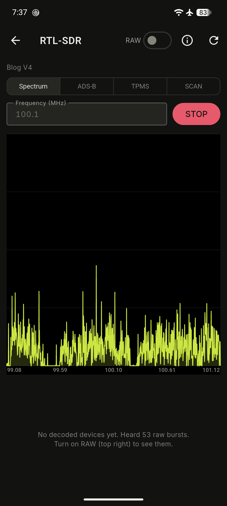
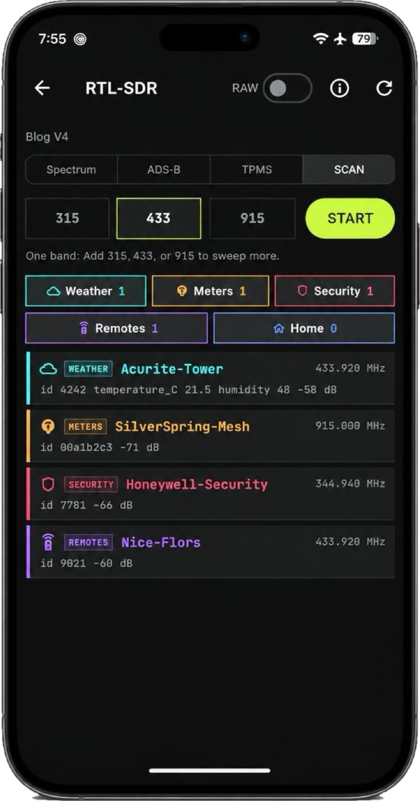
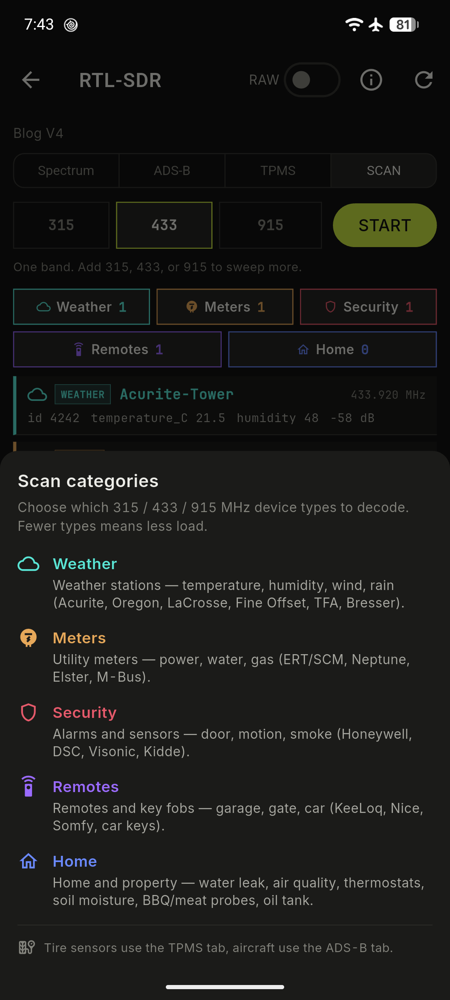
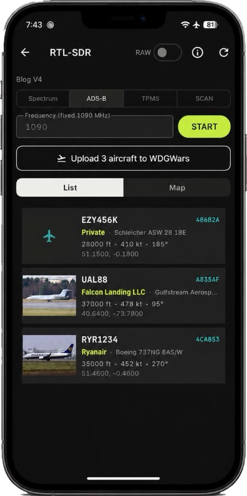

<div align="center">

[](https://github.com/lukeswitz/oui-spy-unified-blue/releases)
[](https://testflight.apple.com/join/5RCKgnJ2)


[](https://github.com/lukeswitz/oui-spy-unified-blue/actions/workflows/github-code-scanning/codeql)

# OUI-APEX

**"Snoop unto them - as they snoop unto us".**

</div>

- ESP32 firmware and standalone phone app for detecting surveillance hardware, trackers and drones, and for wardriving. One firmware runs every detection engine; the app turns them on and off, maps results, and uploads to WiGLE and WDGWars. 

- The phone is a radio too — run it alone, or have a board detect while the phone foxhunts. **Android scans Bluetooth and Wi-Fi; iPhone and Mac scan Bluetooth LE only.**

- **On Android**, extend the phone further with an RTL-SDR dongle or most USB Wi-Fi adapter chipsets.

> [!NOTE]
> Runs the [OUI-SPY ecosystem](https://github.com/colonelpanichacks) by colonelpanichacks with additional features.

**Not affiliated with OUI-SPY.** Beta, bugs can exist. 


## Quick start

1. Flash a board from the [web flasher](https://lukeswitz.github.io/oui-spy-unified-blue/) (Chrome or Edge, USB). Pick the **NODE** target for your board. Later updates come from the app.
2. Install the app: [Android / macOS](https://github.com/lukeswitz/oui-spy-unified-blue/releases/latest) or [iOS / macOS TestFlight](https://testflight.apple.com/join/5RCKgnJ2).
3. Open the app, tap **CONNECT**, pick the board.

- **Android:** set Location to **Allow all the time**, or scanning stops when the screen is off.
- **macOS:** the release zip is signed but not notarized, so Gatekeeper blocks the first launch. For a notarized build, use [TestFlight](https://testflight.apple.com/join/5RCKgnJ2).

## Ways to run a board

| Mode | How | What you get |
|---|---|---|
| **App** | Phone connected over Bluetooth | Every engine, live feed, map, GPS from the phone, PCAP saved on the phone |
| **Standalone** | No phone; boards with a screen and buttons | Engines started from the buttons. T-Dongles log to microSD; M5Sticks beep and show hits on screen |
| **Mesh node** | Board runs under a MANAGER the phone connects to | The manager collects every node's hits; settings from the app reach all nodes |
| **Phone only** | No board; PHONE SCAN on | Wardrive, classify, alert and foxhunt with the phone's radios: Bluetooth and Wi-Fi on Android, Bluetooth on iPhone |

- **Together:** the board keeps detecting while the phone foxhunts a device it found, or both scan into one session.
- **Offline scan** (SETTINGS → NODE → HARDWARE): a board keeps scanning after the phone disconnects. Hits buffer to flash and upload on reconnect. The setting survives a reboot.

## Boards

| Board | Bands | Screen / buttons | microSD | Buzzer | Mesh node | Flasher target |
|---|---|---|---|---|---|---|
| XIAO ESP32-S3 | 2.4 GHz | – | – | GPIO3 (OUI-SPY board) | yes | `node-xiao_s3` |
| ESP32-S3 N16R8 DevKitC | 2.4 GHz | – | – | GPIO3 | yes | `node-s3_devkitc` |
| XIAO ESP32-C5 *(experimental)* | 2.4 + 5 GHz | – | – | GPIO25 | yes | `node-xiao_c5` |
| LilyGO T-Dongle-S3 | 2.4 GHz | LCD, 1 button, RGB LED | yes | none | yes | `node-tdongle_s3` |
| LilyGO T-Dongle-C5 *(experimental)* | 2.4 + 5 GHz | LCD, 1 button, RGB LED | yes | none | yes | `node-tdongle_c5` |
| M5StickC PLUS | 2.4 GHz | LCD, 3 buttons | – | built in | yes | `node-stickc_plus` |
| M5StickC PLUS2 | 2.4 GHz | LCD, 3 buttons | – | built in | **no** | `node-stickc_plus2` |
| M5StickC (original) | 2.4 GHz | LCD, 3 buttons | – | none | **no** | `node-stickc` |

- **Manager boards:** XIAO ESP32-S3 (`mgr-xiao_s3`), ESP32-S3 DevKitC (`mgr-s3_devkitc`), XIAO ESP32-C5 (`mgr-xiao_c5`), XIAO ESP32-C3 (`mgr-xiao_c3`), ESP32 WROOM (`mgr-wroom`). A manager does no scanning.
- **No mesh:** the original M5StickC and the PLUS2 skip mesh to fit their RAM. They connect straight to the phone or run standalone.
- **No buzzer:** the app hides the buzzer settings on boards that lack one.

## USB radios on Android

Plug a USB Wi-Fi adapter or an RTL-SDR dongle into an Android phone and OUI-APEX drives it directly — no root, kernel driver, or custom ROM.

- **User space:** the app talks to the adapter through Android's USB API, so it works on a stock phone.
- **Concurrent:** the phone's own Wi-Fi and Bluetooth keep running while the adapter scans.
- **Setup:** plug it in, choose OUI-APEX when Android asks, and tick "Use by default for this USB device". It appears on the Home screen with its own START control and waits there — it does not scan until you start it.
- **Reclaim:** with "use by default" set, the app grabs the adapter again after a restart, so you don't have to unplug and replug it.

### Wi-Fi adapters

- **Receive only:** the adapter scans in monitor mode; the app never transmits through it.
- **Firmware:** on first use the app downloads the chipset's firmware from [linux-firmware](https://git.kernel.org/pub/scm/linux/kernel/git/firmware/linux-firmware.git/), checks it against a pinned SHA-256, and caches it on the phone.
- **Per AP:** each access point is recorded with its channel and security from the beacon — open, WEP, WPA, WPA2, or WPA3.

| Chipset | Scans |
|---|---|
| MediaTek MT7921AU | Wi-Fi (2.4 + 5 GHz) and Bluetooth LE |
| MediaTek MT7612U | Wi-Fi (2.4 GHz) |
| Realtek RTL8812AU / RTL8814AU / RTL8821AU | Wi-Fi |
| Atheros AR9271 | Wi-Fi (2.4 GHz) |
| Ralink RT3070 | Wi-Fi (2.4 GHz) |

**The MT7921AU (Alfa AWUS036AXM) is the one to get.** It covers both bands and is the only adapter here that also scans Bluetooth LE — pick BLE or WiFi+BLE on the radio control and it runs the Bluetooth radio next to the Wi-Fi capture. Its Wi-Fi hits are tagged `USB WIFI` and its Bluetooth hits `USB-BLE`, so you can tell them from the phone's own radios.

### RTL-SDR

An RTL-SDR dongle, an RTL2832U with USB ID `0bda:2832` or `0bda:2838`, turns the phone into a software-defined radio receiver. Open it from the SDR screen and pick a mode.

| Mode | Frequency | What it receives |
|---|---|---|
| Spectrum | You set it, 100.1 MHz by default | A live waterfall of signal strength across the band |
| ADS-B | 1090 MHz | Aircraft broadcasting their position and identity |
| TPMS | 315, 433.92, or 915 MHz | Tire-pressure sensors in passing vehicles |
| SCAN | 315, 433.92, or 915 MHz | Devices the rtl_433 decoders recognize: weather stations, utility meters (including Wireless M-Bus), security sensors, remotes and key fobs, and home sensors |



In SCAN mode you pick which categories to decode: **Weather, Home, Meters, Security, Remotes**. The app runs only those decoders, so a narrower scan does less work on the phone.

- The info button at the top explains each category, and every list row shows its icon.
- Each decoder checks the device's checksum and drops readings that fail it, so noise doesn't show up as a device.
- Decoded devices save to History under an SDR filter, and you can foxhunt one by its signal strength.
- Tire sensors have their own **TPMS** tab, which reads them more reliably than SCAN.

<p>
  
  
</p>

On the **ADS-B** tab:

- Each aircraft is a card with callsign, altitude, speed, heading, and a photo looked up online by its ICAO address.
- The map view draws each aircraft's flight path from the positions it has broadcast.
- One button uploads the aircraft you've heard to WDGWars.



## Engines

| Engine | Finds |
|---|---|
| **Detector** | Your watchlist (MAC, OUI prefix, name, 16-bit BLE service UUID), plus built-in signatures, all off by default: Find My / AirTag following you, Flipper Zero, Wi-Fi deauth floods, directed probes, Pwnagotchi, Meta Ray-Ban / Oakley glasses, Axon / law-enforcement gear, security / doorbell / dash cameras by vendor OUI (Ring, Nest, Arlo, Blink, Wyze, Hikvision, Dahua and others), Amazon Sidewalk BLE |
| **Flock BLE / Flock WiFi** | Flock Safety ALPR cameras and Raven gunshot sensors. Optional OUI-only Wi-Fi hits |
| **Sky Spy** | Drones broadcasting FAA Remote ID over BLE and Wi-Fi: ID, position, altitude, speed, pilot position |
| **Foxhunter** | One target device. Beep rate (or the RSSI meter on boards without a buzzer) rises as you get closer |
| **UniPwn** | Unitree robots by BLE name (`Go2_`, `G1_`, `H1_`, …) |
| **Wardrive** | Every Wi-Fi AP and BLE device, GPS-stamped, WiGLE CSV format. 2.4 GHz channels 1–14 by default; C5 boards add 5 GHz including DFS |
| **PCAP** | Raw 802.11 or BLE advertising frames to a Wireshark `.pcap` |

> [!IMPORTANT]
> The Flock OUI list comes from upstream FlockYou and matches Ubiquiti, Espressif and other common consumer parts. Check a hit with your own eyes before reporting it anywhere.

### Flock confidence

| Tier | Matched |
|---|---|
| **VERIFIED** | Bare-serial name + XUNTONG `0x09C8` manufacturer ID + TN serial |
| **HIGH** | One strong signal: Raven service UUID, Flock BLE name, or a Flock wildcard probe |
| **SUSPECTED** | A listed OUI only |

The tier shows on feed rows, in the detail sheet, and in DETECTIONS → HISTORY, which can filter by tier.

## App

Bottom tabs: **HOME · DETECTIONS · MAP · SETTINGS**.

- **Home**: session bar (targets, radio, START / PAUSE / STOP) and one card per engine. Status bar shows link, GPS fix and node count.
- **Detections**: LIVE (every hit; filter, sort, search, export), DEVICES (each device classified by vendor, Bluetooth data and signatures), HISTORY (stored log, CSV export). Tap a row to foxhunt or map it; SHOW ALL on the map shows its whole class.
- **Classification**: OUI vendor categories, Bluetooth SIG company and service IDs, AntiHunter tables, Fieldwatch signatures. Each device gets a class (trackers, cameras, public safety & fleet, drones, glasses, hacking tools, routers, home & office, …), a confidence dot, and its decoded advertisement (Apple Continuity type, manufacturer data, service UUIDs). Class alerts are on by default.
- **Phone scan**: phone icon in the status bar, off at launch. Android scans Bluetooth and Wi-Fi, with or without a board; iPhone and Mac scan Bluetooth only. Hits show as node PHONE. iOS hides MACs, so iPhone hits skip WiGLE CSV.
- **USB radios**: on Android, an external USB Wi-Fi adapter or an RTL-SDR plugs into the phone and scans in user space, no root needed. See [USB radios on Android](#usb-radios-on-android).
- **Notifications**: title is the matched target (watchlist name, signature, probed SSID); body is RSSI, channel, name, MAC.
- **Watchlist**: import and export as CSV or JSON in SETTINGS → RULES.
- **Alert sounds**: choose a built-in melody or compose your own for each alert type, and preview it on the board.
- **Map**: choose targets (WiGLE / Flock / Drone / Detector) and radio (Wi-Fi / BLE / both), then START. Sessions save as WiGLE CSV, upload to [WiGLE](https://wigle.net) and [WDGWars](https://wdgwars.pl), and replay on the map.
- **Map layers**: *MAPPED ALPRs* scores each Flock hit against OpenStreetMap cameras (`ON MAP` ≤75 m, `UNMAPPED` >250 m), querying `overpass-api.de` (fallback `overpass.private.coffee`). *WDG TERRITORY* shows a linked account's WDGWars territory.
- **Geofences**: inside a zone, detections drop from feed, log and notifications; the board stops beeping and auto-PCAP. A map session also turns its radios off until you leave (**RADIOS OFF — INSIDE EXCLUSION ZONE**). HOME-started engines keep scanning; a T-Dongle still writes to SD.
- **PCAP**: capture Wi-Fi or BLE; pause and resume. Auto-PCAP records 3–120 s whenever an engine fires. SETTINGS → DATA → PCAPS lists saved captures.
- **SETTINGS**: APP, SCANNING, RULES (watchlist, signatures, ignore list), ALERTS, NODE (HARDWARE, MESH, FIRMWARE), DATA (ACCOUNTS, PCAPS, EXPORT).
- **iOS**: live counts and alerts on the Lock Screen and Dynamic Island during a session, and in CarPlay on iOS 26.
- **Android**: during a session, an ongoing notification shows live counts and the last alert.


## Internet services

- **No analytics or crash reporting.**
- The app connects to a service below only when you use its feature.
- Detections, sessions and captures stay on the phone until you upload or export them.

| Service | When the app connects | What it sends | Usage rules the app follows |
|---|---|---|---|
| [WiGLE](https://api.wigle.net) | Sign in or upload a session | API name + token; session file on upload | On HTTP 429, pauses WiGLE 24h ("Try again in 24hr" on HOME and **Settings → Data → Accounts**). Each session uploads once, on confirm. |
| [WDGWars](https://wdgwars.pl) | Link an account, upload a session, or turn on **WDG TERRITORY** | API key; compressed session file; territory requests | UA `oui-spy-companion/1.0`. Retries an upload twice (2s, 8s) on dropped connection or server error. Honors the server's rate-limit wait. Territory refreshes at most every 5 min. Shows returned counts after upload. |
| [Overpass API](https://wiki.openstreetmap.org/wiki/Overpass_API) (`overpass-api.de`, fallback `overpass.private.coffee`) | **MAPPED ALPRs** on (off by default) and you move the map or open a Flock hit | The map corners in view | UA `oui-spy-companion/1.0`. Caches areas 7 days, one request at a time. On HTTP 429 waits 30s or longer. |
| [OpenFreeMap](https://openfreemap.org) styles: Dark (default), Fiord, Liberty, Bright, Positron | A map is on screen | Tile numbers in view | No account or key, no limit. Tiles cached 30 days (≤50 MB). Shows "OpenFreeMap © OpenMapTiles Data from OpenStreetMap". |
| [USGS The National Map](https://www.usgs.gov/faqs/what-are-terms-uselicensing-map-services-and-data-national-map): Satellite (US) | You pick Satellite (US) | Tile numbers in view | Public domain, no account. US only. Tiles cached 7 days (≤200 MB). Enlarges zoom-16 tiles past zoom 16. Shows USGS credit. |
| [GitHub](https://docs.github.com/en/rest/using-the-rest-api/rate-limits-for-the-rest-api) | You tap **Check for Update** (Settings → Node → Firmware) | Nothing about you or your board | UA `oui-spy-companion/1.0`. 60 checks/hour per IP; pauses to GitHub's reset. Firmware comes from the same release. |
| [Wireshark](https://www.wireshark.org/download/automated/data/) | You tap **Check for Update** (Settings → Data → Export → OUI DATABASE) | Nothing | Fetches the MAC vendor list at most every 7 days. UA `oui-spy-companion/1.0`. |
| [FAA DroneZone](https://uasdoc.faa.gov) | You tap **FAA RemoteID Lookup** on a drone | The drone's Remote ID serial | UA `oui-spy-companion/1.0`. Caches a registration 30 days. Retries only on HTTP 502, up to 3×. |

## Standalone controls

### T-Dongle-S3 / T-Dongle-C5

| Press | Action |
|---|---|
| 1 press | Select next mode |
| 2 presses | Start / stop selected mode |

Modes: `DETECT FLOCKB FLOCKW FOXHNT SKYSPY UNIPWN WARDRV PCAP`.

Files go to `/OUISPY` on the card:

| File | Contents |
|---|---|
| `det_*.csv` | Every detection, with coordinates when a GPS fix exists |
| `wigle_*.csv` | Wardrive rows; written only with a GPS fix (phone or GPS module) |
| `cap_*.pcap` | Packet captures |

- **Filenames** use UTC time once GPS supplies it, otherwise a boot counter.
- **LED:** glows dim green while an engine runs, flashes the engine's color on a hit. The app's NeoPixel brightness slider sets the level; 0 turns it off.

### M5StickC / PLUS / PLUS2

| Button | Press | Action |
|---|---|---|
| **A** (front) | tap | Select next mode |
| **A** | hold | Foxhunt the last alert (or the app's target); hold again to stop |
| **B** (side) | tap | Start / stop selected mode |
| **B** | hold | Buzzer on / off (PLUS and PLUS2) |
| **PWR** | tap | Screen brightness, four steps, last is off |
| **PWR** | hold | Power off |

Modes: `DETECT FLOCKB FLOCKW FOXHNT SKYSPY UNIPWN`. Wardrive and PCAP need the app on these boards (no SD card).

### Screen (both)

- **Top left:** selected mode (amber = selected, green = running).
- **Top right:** `APP` `MSH` `SD` `GPS` status.
- **Left:** unique Wi-Fi and BLE counts.
- **Right:** foxhunt target, `CAP` bytes while capturing, or speed.
- **Bottom strip:** one icon per mode, lit while running, underlined when selected, hit count below.

Foxhunt picks, in order: the target set in the app, else the last Detector / Flock / Sky Spy / UniPwn alert seen by this board.

## Mesh

- One MANAGER connects to the phone; up to 6 NODES report to it over ESP-NOW on 2.4 GHz channel 1.
- Nodes join on their own within about 10 s. Single hop: every node must reach the manager directly, about 200 m line of sight.
- Default is plaintext broadcast. SETTINGS → NODE → MESH can switch to AES-256-GCM with a shared key.
- Boards use a random MAC each boot; the node ID stays fixed.
- A node silent for 45 s drops off and rejoins when back in range.
- Buzzer, LED, alert, alert-sound, ignore-list, wardrive-radio and Wi-Fi-band settings set on the manager are pushed to every node.
- Any mix of node boards works under one manager (e.g. T-Dongle-S3 + T-Dongle-C5 + M5StickC PLUS + XIAO).
- Each node reports its board to the manager; the app shows it on every node row.
- Fleet update (SETTINGS → NODE → FIRMWARE) updates every node over Wi-Fi, and each node downloads the image for its own board. Nodes older than v0.6.1 do not report a board and take the image for the board picked in the app.

## Optional GPS module

A serial GPS (NEO-6M / NEO-8M, 9600 baud) gives the board its own position. A module fix takes priority; with no data for 5 s the board falls back to phone GPS.

| GPS | XIAO ESP32-S3 | T-Dongle-S3 | T-Dongle-C5 | M5Stick |
|---|---|---|---|---|
| TX → | GPIO44 | GPIO44 | GPIO12 | GPIO33 |
| RX ← | GPIO43 | GPIO43 | GPIO11 | GPIO32 |

Other boards: set `-DPIN_GPS_RX=` / `-DPIN_GPS_TX=`.

## Build

```bash
pio run -e v3_app_controlled                 # node, XIAO ESP32-S3
pio run -e v3_app_controlled_tdongle_s3      # node, T-Dongle-S3
pio run -e v3_app_controlled_stickc_plus     # node, M5StickC PLUS (also _stickc, _stickc_plus2)
./build_c5.sh                                # node, XIAO ESP32-C5
OUISPY_C5_ENV=v3_app_controlled_tdongle_c5 ./build_c5.sh   # node, T-Dongle-C5
pio run -e v3_node_manager_s3                # manager, XIAO ESP32-S3 (also _s3_devkitc, _xiao_c3, _wroom)
OUISPY_C5_ENV=v3_node_manager_c5 ./build_c5.sh             # manager, XIAO ESP32-C5
```

C5 builds use the pioarduino platform in a separate core dir (`~/.platformio-c5`) via `build_c5.sh`.

```bash
cd companion && flutter pub get && flutter build apk --release   # or ipa / macos
```

**Firmware libraries:** [NimBLE-Arduino](https://github.com/h2zero/NimBLE-Arduino), [TinyGPS++](https://github.com/mikalhart/TinyGPSPlus), [Adafruit GFX](https://github.com/adafruit/Adafruit-GFX-Library); ESP-IDF ESP-NOW and mbedTLS.

**Map tiles:** [OpenFreeMap](https://openfreemap.org/) with [OpenMapTiles](https://openmaptiles.org/) and [OpenStreetMap](https://www.openstreetmap.org/copyright) data; satellite imagery from [USGS The National Map](https://www.usgs.gov/programs/national-geospatial-program/national-map). 

**Vendor OUIs** from the IEEE MA-L, MA-M and MA-S registries via [Wireshark manuf](https://www.wireshark.org/download/automated/data/manuf.gz).

## Credits

- Upstream engines: [Detector](https://github.com/colonelpanichacks/ouispy-detector), [Foxhunter](https://github.com/colonelpanichacks/ouispy-foxhunter), [Flock You](https://github.com/colonelpanichacks/flock-you), [Sky-Spy](https://github.com/colonelpanichacks/Sky-Spy), [UniPwn](https://github.com/colonelpanichacks/Oui-Spy-UniPwn) by **colonelpanichacks**.
- **Will Greenberg** ([flock-you](https://github.com/wgreenberg/flock-you)): XUNTONG `0x09C8` detection.
- **@NitekryDPaul / OrdoOuroborous** ([@nitekry](https://github.com/nitekry)): promiscuous Flock OUI set and the addr1 receiver technique.
- **DeFlockJoplin** ([flock-you](https://github.com/DeflockJoplin/flock-you)): wildcard-probe signature.
- **OffGridPete** ([Fieldwatch](https://github.com/OffGridPete/Fieldwatch)): device signature catalog and classifier.
- Company and service IDs: [Bluetooth SIG assigned numbers](https://bitbucket.org/bluetooth-SIG/public).
- OUI sources: [zmattmanz](https://github.com/zmattmanz), [dougborg/AirHound](https://github.com/dougborg), [VirtuallyScott](https://github.com/VirtuallyScott).

## Disclaimer

Security-research and privacy-auditing tool. Follow local law on wireless scanning. Lawful use only.
