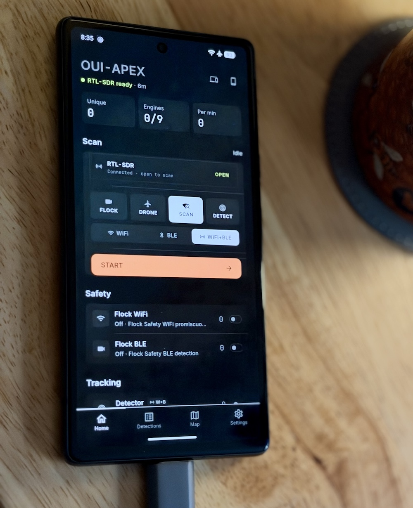
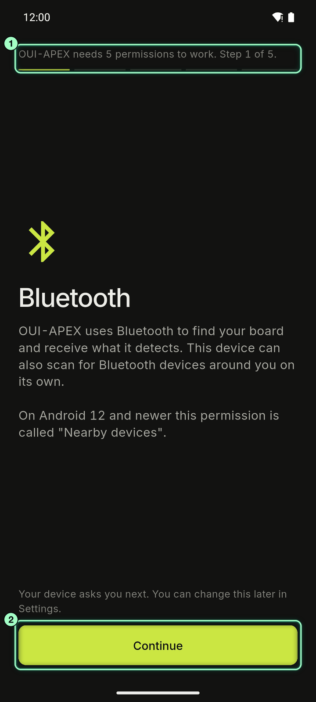
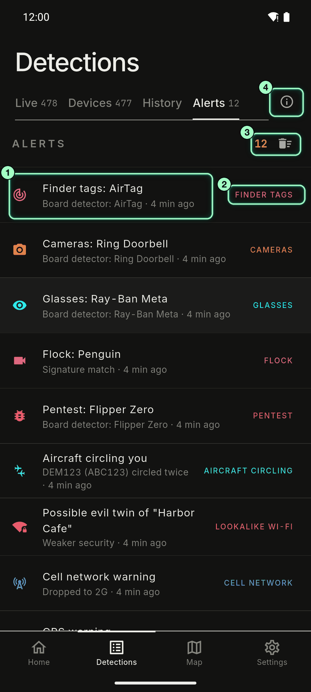
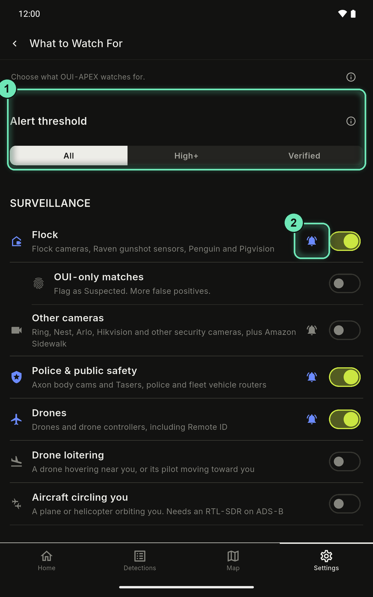
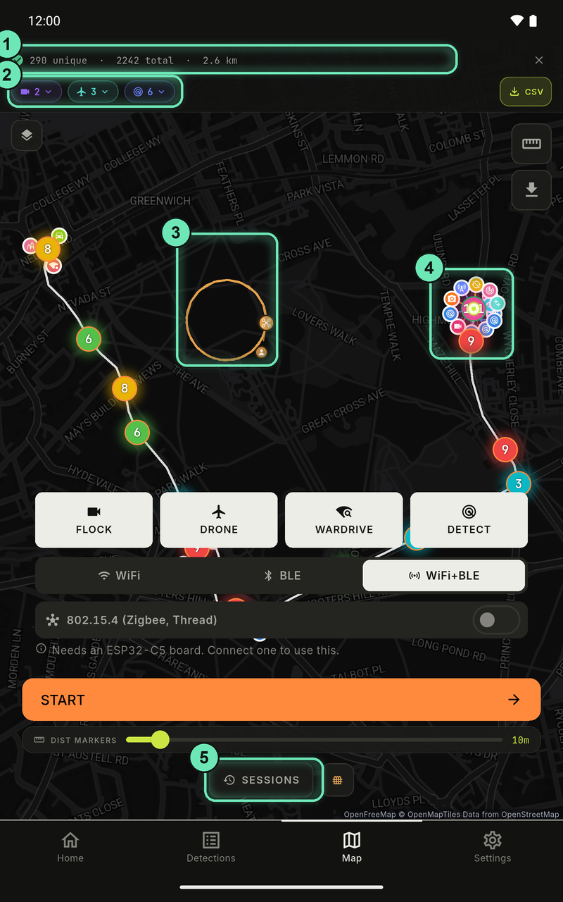
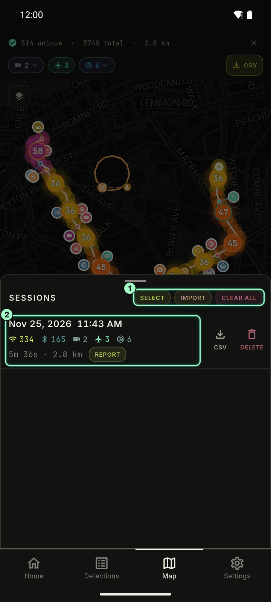

<div align="center">

[](https://github.com/lukeswitz/oui-spy-unified-blue/releases)
[](https://testflight.apple.com/join/5RCKgnJ2)


[](https://github.com/lukeswitz/oui-spy-unified-blue/actions/workflows/github-code-scanning/codeql)

# OUI-APEX


</div>

<div align="center">
<b>OUI-APEX detects surveillance hardware, trackers and drones.</b> Wardriving and recon app with support for external USB devices.
<p>

<a href="#quick-start"><b>Quick start</b></a> &middot; <a href="#a-tour-of-the-app"><b>Tour</b></a> &middot; <a href="#engines"><b>Engines</b></a> &middot; <a href="#boards"><b>Boards</b></a> &middot; <a href="#mesh"><b>Mesh</b></a> &middot; <a href="#usb-radios-on-android"><b>USB radios</b></a>
<p>

<table>
  <tr>
    <td></td>
    <td></td>
  </tr>
</table>

| Platform | Phone scans | Detects on its own (no board) | Add-ons |
|---|---|---|---|
| Android | Bluetooth, Wi-Fi | Wi-Fi networks and Bluetooth devices, sorted into types such as trackers, cameras, glasses and hacking tools. Drones that send Remote ID over Bluetooth or Wi-Fi. Phones with Wi-Fi Aware also catch drones that send it that way | ESP32 board(s), RTL-SDR, USB Wi-Fi adapter |
| iPhone / macOS | Bluetooth | Bluetooth devices, sorted into types. Does not detect drones without an ESP32 | ESP32 board(s) |

</div>

> Runs the OUI-SPY ecosystem by colonelpanichacks, with additional features.
>
> *Not affiliated with OUI-SPY*
  

## Quick start

_How it Works:_
- **Firmware (ESP32):** Runs combined OUI-SPY firmware. Add more boards to form an ESP-NOW mesh perimeter (up to 200m apart).
- **App:** controls the firmware, maps detections, and exports or uploads to WiGLE and WDGWars.
- **Phone:** scans by itself (limited), or foxhunts (tracks a signal to its source) while the boards keep detecting.

_Getting Started:_
1. Flash a board from the [web flasher](https://lukeswitz.github.io/oui-spy-unified-blue/) (Chrome or Edge, USB). Pick the **NODE** target for your board. Later updates come from the app.
2. Install the app: [Android / macOS](https://github.com/lukeswitz/oui-spy-unified-blue/releases/latest) or [iOS / macOS TestFlight](https://testflight.apple.com/join/5RCKgnJ2).
3. Open the app, tap **CONNECT**, pick the board.

- **Android:** set Location to **Allow all the time**, or scanning stops when the screen is off.
- **macOS:** Gatekeeper blocks the first launch of the release zip because it is not notarized. [TestFlight](https://testflight.apple.com/join/5RCKgnJ2) builds are.

> [!IMPORTANT]
> **Turn off Android's Wi-Fi scan limit.** Android allows four Wi-Fi scans every two minutes and fails the rest.
>
> 1. **Settings → About phone**: tap **Build number** seven times to turn on Developer options.
> 2. **Settings → System → Developer options → Networking**: turn off **Wi-Fi scan throttling**.
>
> Menu paths vary by phone. USB Wi-Fi adapters are not limited.

## A tour of the app

Every screen below is the app itself on Android, filled with made-up devices along a made-up drive through Greenwich, London. The numbers on each screen match its key.

### First launch

The app asks for each permission on its own screen, then opens Home.

<table>
  <tr>
    <td width="33%" valign="top">
      <ol>
        <li><b>Progress</b>: which permission step you are on. Android asks for five.</li>
        <li><b>Why</b>: what the app uses this permission for.</li>
        <li><b>Continue</b>: your phone shows its own prompt next.</li>
      </ol></td>
    <td width="33%" valign="top">
      <ol>
        <li><b>Location all the time</b>: needed to keep wardriving with the screen off.</li>
        <li><b>Continue</b>: opens Settings. Choose <b>Allow all the time</b>, then go back.</li>
      </ol></td>
    <td width="33%" valign="top">
      <ol>
        <li><b>Status</b>: board link and GPS fix.</li>
        <li><b>Shortcuts</b>: the arrows open the Connect screen. The phone icon starts the phone scan.</li>
        <li><b>CONNECT</b>: find your board over Bluetooth.</li>
        <li><b>USE THIS DEVICE</b>: scan with the phone's own radios.</li>
        <li><b>Engines</b>: what each engine looks for.</li>
      </ol></td>
  </tr>
</table>

### Start a scan

Pick what to look for and which radios to use, then tap START.

<table>
  <tr>
    <td width="50%" valign="top">
      <ol>
        <li><b>Counters</b>: unique devices, engines running, and hits per minute.</li>
        <li><b>Targets</b>: Flock cameras, drones, every Wi-Fi and BLE device (SCAN), and your watchlist (DETECT).</li>
        <li><b>Radio</b>: Wi-Fi, BLE or both.</li>
        <li><b>START</b>: starts a session. The app then asks which radio each board uses.</li>
        <li><b>Engine cards</b>: turn one engine on or off by itself.</li>
      </ol></td>
    <td width="50%" valign="top">
      <ol>
        <li><b>Status</b>: what is scanning and how good the GPS fix is.</li>
        <li><b>Counters</b>: update live.</li>
        <li><b>PAUSE / STOP</b>: pause or end the session. A stopped session is saved.</li>
        <li><b>Hit counts</b>: hits per engine this session, next to its switch.</li>
      </ol></td>
  </tr>
</table>

### Detections

Everything the boards and the phone hear, live. Tap any row for its details.

<table>
  <tr>
    <td width="50%" valign="top">
      <ol>
        <li><b>Tabs</b>: LIVE hits, classified DEVICES, stored HISTORY and ALERTS.</li>
        <li><b>Tools</b>: filter, sort, group Wi-Fi clients under their network, open HISTORY, and more.</li>
        <li><b>Top vendors and Flock</b>: tap a vendor to show only its devices.</li>
        <li><b>A drone</b>: its Remote ID, the radio that heard it, and its altitude.</li>
        <li><b>A detector hit</b>: here a camera, with its channel and hit count.</li>
        <li><b>A Flock hit</b>: with its confidence.</li>
      </ol></td>
    <td width="50%" valign="top">
      <ol>
        <li><b>Type</b>: what kind of device this is.</li>
        <li><b>What this looks like</b>: the app's best guess, in plain words.</li>
        <li><b>Foxhunt this device</b>: follow its signal to the source.</li>
        <li><b>Check this AP on WiGLE</b>: look the network up on WiGLE.</li>
        <li><b>Trust this network</b>: warns you later about lookalikes. See <a href="#watches-and-alerts">Watches and alerts</a>.</li>
        <li><b>Map, Copy, Delete</b>: show it on the map, copy its MAC address, or remove it.</li>
      </ol></td>
  </tr>
</table>

### Alerts and what to watch for

Choose which device types alert you. Every alert lands in one list.

<table>
  <tr>
    <td width="50%" valign="top">
      <ol>
        <li><b>An alert</b>: what was found, why, and when. Tap it for the map and the device.</li>
        <li><b>Kind</b>: each kind has its own color.</li>
        <li><b>Count and clear</b>: how many alerts, and a button to clear them.</li>
        <li><b>Info</b>: explains each tab and icon.</li>
      </ol></td>
    <td width="50%" valign="top">
      <ol>
        <li><b>Alert threshold</b>: how sure a detector hit must be before it notifies you.</li>
        <li><b>A device type</b>: what it covers.</li>
        <li><b>Bell</b>: notify, or only log it.</li>
        <li><b>Switch</b>: watch for this type or not.</li>
      </ol></td>
  </tr>
</table>

### Map

Every hit is placed where you heard it, along your route. The numbers are how many hits share a spot.

<table>
  <tr>
    <td width="50%" valign="top">
      <ol>
        <li><b>Session</b>: time recording, and counts of Wi-Fi, Flock, drone, detector and BLE hits.</li>
        <li><b>Flock list</b>: tap the chip to open or close it. Drones and detector hits have their own.</li>
        <li><b>Each hit</b>: its name, type, address and signal. Tap a row to zoom the map to it.</li>
        <li><b>Drive</b>: distance, speed, hits per km, and Stop / Pause.</li>
      </ol></td>
    <td width="50%" valign="top">
      <ol>
        <li><b>Saved session</b>: unique devices, total hits and distance.</li>
        <li><b>Lists</b>: Flock, drone and detector hits from this session.</li>
        <li><b>CSV</b>: export the session as a WiGLE CSV.</li>
        <li><b>Layers</b>: map style and extra layers.</li>
        <li><b>A drone</b>: its flight path and its pilot.</li>
        <li><b>A cluster</b>: tap it to list the devices there.</li>
        <li><b>Targets</b>: what the next session looks for.</li>
        <li><b>Radio</b>: Wi-Fi, BLE or both.</li>
        <li><b>START</b>: start a new session.</li>
        <li><b>SESSIONS</b>: open, export or delete saved sessions.</li>
      </ol></td>
  </tr>
</table>

### Sessions and reports

Every session is saved. Open one to replay it on the map, or open its report.

<table>
  <tr>
    <td width="33%" valign="top">
      <ol>
        <li><b>SELECT, IMPORT, CLEAR ALL</b>: pick several sessions, load a WiGLE CSV, or delete them all.</li>
        <li><b>A session</b>: when, how long, how far, and its Wi-Fi, BLE, Flock, drone and detector counts. Tap it to replay it on the map.</li>
        <li><b>REPORT</b>: opens the report.</li>
        <li><b>CSV, DELETE</b>: export or remove this session.</li>
      </ol></td>
    <td width="33%" valign="top">
      <ol>
        <li><b>Session</b>: start time, length and distance.</li>
        <li><b>Totals</b>: Wi-Fi networks, how many were new, and Bluetooth devices.</li>
        <li><b>Route</b>: where you drove.</li>
        <li><b>Wi-Fi networks</b>: new, seen before, hidden, and per band.</li>
        <li><b>Share</b>: sends the report as text.</li>
      </ol></td>
    <td width="33%" valign="top">
      <ol>
        <li><b>Security</b>: how many networks use each kind of security.</li>
        <li><b>Top makers</b>: the most common device makers.</li>
        <li><b>Detections</b>: Flock cameras, drones and watchlist hits.</li>
        <li><b>Alerts</b>: every alert kind raised during the session. Further down, whether it was uploaded to WiGLE and WDGWars.</li>
      </ol></td>
  </tr>
</table>

### Tips

- **Rename a board or mesh node:** go to SETTINGS → NODE → MESH → **Nodes**, tap the node, type a name of up to 32 characters, and tap **SAVE**. Leave it blank or tap **CLEAR** to go back to the node ID. The name is kept on this phone. You can also tap the pencil next to a board on the Connect screen after its first connection.
- **Find or restart a mesh node:** with a manager connected, tap a live node under SETTINGS → NODE → MESH → **Nodes**. **Identify** makes it beep and blink for 10 seconds. **Locate** makes it beep every 2 seconds until you tap **Stop locate**, for 30 minutes at most. **Reboot** restarts it. **Fleet control** below the list identifies or reboots every node at once.
- **Remove an old node:** in the same **Nodes** list, tap a node you no longer use and tap **FORGET**. The board you are connected to cannot be forgotten there.
- **Forget a paired board:** hold it on the Connect screen.
- **Too many notifications:** when alerts pile up within a minute, the app offers to turn off notifications for one noisy type. Its detections are still logged.
- **Filter by maker:** on LIVE, tap a vendor in the strip above the list to show only its devices.
- **Search everything:** on LIVE, open search and type. Every word must match a MAC, name, maker, reason or node. Chips show the matches in Devices, Alerts, Drones, Nodes and Wardrive. Tap a chip or **EVERYTHING** for the results sheet, and tap a match to open it.
- **Live counts:** above LIVE, nodes online, devices heard in the last minute, live drones, devices heard today, unread alerts and MACs kept. Under them, the devices heard in each of the last 24 hours and their total.
- **Hide addresses for screenshots:** turn on **Mask identifiers on screen** in SETTINGS → Detection & Alerts → Privacy.
- **What does this icon mean:** tap the info button on a screen. It explains each tab and icon there.

## Engines

| Engine | Finds |
|---|---|
| **Detector** | Your watchlist (MAC, OUI prefix, name, 16-bit BLE service UUID), plus built-in signatures, all off by default: tracker tags following you (AirTag, AirPods and other Find My items, SmartTag, Tile, Google Find Hub, Chipolo, Pebblebee, DULT-standard tags), floods of new tracker tag addresses, Flipper Zero, Wi-Fi deauth floods, floods of join requests at one access point, Wi-Fi beacon floods (one radio faking 15+ networks), directed probes, evil-twin and KARMA rogue access points, Pwnagotchi, Meshtastic and MeshCore mesh radios, Meta Ray-Ban / Oakley glasses, Axon / law-enforcement gear, Motorola Solutions radios and body cams, i-PRO body cams, police and fleet vehicle routers, security / doorbell / dash cameras by vendor OUI or camera brand in the network or device name (Ring, Nest, Arlo, Blink, Wyze, Hikvision, Dahua and others), Amazon Sidewalk BLE, wearable cameras and recorders (GoPro, Insta360, Snap Spectacles, Even Realities, Vuzix, Brilliant Labs Frame, PLAUD), vehicles (Teslas, Bluetooth OBD-II dongles), drones over Bluetooth (Remote ID, DJI) |
| **Flock BLE / Flock WiFi** | Flock Safety ALPR cameras, Raven gunshot sensors, Penguin and Pigvision. Optional OUI-only Wi-Fi hits |
| **Sky Spy** | Drones broadcasting FAA Remote ID over BLE and Wi-Fi: ID, position, altitude, speed, pilot position |
| **Foxhunter** | One target device. Beep rate (or the RSSI meter on boards without a buzzer) rises as you get closer. The app's FIND IT view shows the signal in dBm and a ring that pulses faster as it climbs (every 1.4 s weak, every 0.09 s close), and the phone buzzes with each pulse; **Buzz on** / **Buzz off** switches it, and a Mac has no buzz. The reading comes from the node that hears the device best |
| **UniPwn** | Unitree robots by BLE name (`Go2_`, `G1_`, `H1_`, …) |
| **Wardrive** | Every Wi-Fi AP and BLE device, GPS-stamped, WiGLE CSV format. 2.4 GHz channels 1–14 by default; C5 boards add 5 GHz including DFS and, with the **802.15.4 (Zigbee, Thread)** switch, passive 802.15.4 receive on channels 11–26 (PAN ID, source address, beacon info, channel, LQI; receive only, never transmits) |
| **PCAP** | Raw 802.11, BLE advertising or (C5 boards) 802.15.4 frames to a Wireshark `.pcap` |

> [!IMPORTANT]
> The Flock OUI list comes from upstream FlockYou and matches Ubiquiti, Espressif and other common consumer parts. Check a hit with your own eyes before reporting it anywhere.

In SETTINGS → **Detection & Alerts** → **What to Watch For**, each type can **alert** (notification plus a map pin), **log only** (tap the bell to record it without notifying), or be off. **OUI-based detection is an optional setting.** **Alert threshold** at the top sets how strong a detector hit must be to notify. **More device types** adds everyday radios: wearables, health, audio, phones / PCs, home IoT, thermostats, access control, vehicles, ISP / routers, mesh, beacons, signage and other.

### Flock confidence

| Tier | Matched |
|---|---|
| **VERIFIED** | Bare-serial name + XUNTONG `0x09C8` manufacturer ID + TN serial |
| **HIGH** | One strong signal: Raven service UUID, Flock BLE name, or a Flock wildcard probe with the Flock IE signature |
| **SUSPECTED** | A listed OUI only, including a wildcard probe without the IE signature |

DETECTIONS → HISTORY can filter by tier. 

## Ways to run

| Mode | How | What you get |
|---|---|---|
| **App + board** | Phone app connected to an ESP32 board over Bluetooth | The board runs the engines. The app controls it, shows the feed and map, adds phone GPS, and saves PCAPs |
| **Standalone** | No phone; boards with a screen and buttons | Engines started from the buttons. T-Dongles log to microSD; M5Sticks beep and show hits on screen |
| **Mesh node** | Board runs under a MANAGER the phone connects to | The manager collects every node's hits; settings from the app reach all nodes |
| **Phone only** | No board; PHONE SCAN on | Wardrive, classify, alert and foxhunt with the phone's own radios. Android also detects drones by Remote ID |
| **Phone + USB radios** | Android, no board; plug in an RTL-SDR and/or a USB Wi-Fi adapter | SDR decodes 315 / 433 / 915 MHz and ADS-B. A USB Wi-Fi adapter scans Wi-Fi, and the MT7921AU also scans Bluetooth LE. Both run alongside the phone's radios |

- **Offline scan** (SETTINGS → NODE → OFFLINE SCAN): the board keeps scanning without the phone, even after a reboot, and uploads hits on reconnect. A directly connected board with a GPS module fix also wardrives, one row per device every 5 min, up to 1 MB. It stops after 60 s without a fix.
- **Private Bluetooth link:** the board changes its private address at random every 5–15 min. After pairing, it hides its name and refuses unknown phones. The paired phone reconnects on its own, even after a reboot. Pairing asks for the board's 6-digit PIN: 123456 on a new board. Change it in SETTINGS → NODE → Firmware → **Bluetooth PIN**. A phone paired before the PIN existed must forget the board and pair again. To pair another phone, restart the board: it accepts one new phone in the 2 min after power-on. After updating an S3, C3 or older ESP32 board, forget it in your phone's Bluetooth settings and pair again.
- **JCMK node hub** (SETTINGS → NODE → JCMK NODE HUB): the board adds Wi-Fi networks from [Piglet](https://github.com/hamspiced/piglet) ESP-NOW nodes to your wardrive. Tap **Start hub**, power on a Piglet, and tap **Pair** under **Nearby nodes**. The hub board leaves the mesh while it runs. The wardrive radio picker can leave out any paired node.

## App

The app controls your boards, shows what they find, and can scan with the phone's own radios. It has four main screens.

| Screen | What it shows |
|---|---|
| **Home** | The session bar (targets, radio, START / PAUSE / STOP) and one card per engine. The status bar shows the link, GPS fix and node count. |
| **Detections** | LIVE lists every hit, with filter, sort, search and export. DEVICES lists classified devices. HISTORY is the stored log, with CSV export. ALERTS lists every alert, newest first. |
| **Map** | Choose targets (WiGLE / Flock / Drone / Detector) and radio (Wi-Fi / BLE / both), then tap START. Sessions save as WiGLE CSV, upload to [WiGLE](https://wigle.net) and [WDGWars](https://wdgwars.pl), and replay on the map. |
| **SETTINGS** | APP, SCANNING (TIMING & RE-LOG, CHANNELS & BAND, EXTERNAL ADAPTERS), DETECTION & ALERTS (WHAT TO WATCH FOR, NOTIFICATIONS, YOUR LISTS, THIS PHONE, PRIVACY), NODE (SOUND & LIGHTS, GPS SOURCE, FLOCK DETECTION, RADIO PRIVACY, OFFLINE SCAN, MESH, FIRMWARE, JCMK NODE HUB), DATA (ACCOUNTS, CAPTURE DATABASE, CAPTURES, EXPORT). |

Tap any hit to see what it is and why, and to foxhunt or map it. SHOW ALL maps every hit of that class.

The info button at the right end of the Detections tab row explains each tab and icon.

| Icon | What it does |
|---|---|
| **Two arrows** (Home) | Opens the Connect screen, with or without a board linked. |
| **Funnel** | Filters by engine, radio, node or class. |
| **Arrow** | Picks the sort order. TIME lists Wi-Fi first, then Bluetooth, newest first. Tap again to reverse. |
| **Layers** | Indents each Wi-Fi client under the network it uses. On LIVE and DEVICES. |
| **Shapes** (DEVICES) | Switches between class sections and one flat list. |
| **Clock** (LIVE) / **Antenna** (HISTORY) | Opens HISTORY / goes back to LIVE. |
| **Folder** (HISTORY) | Opens saved sessions. |
| **Three dots** | More actions for the tab, such as search, export and clear. |
| **Crossed arrows** on a row | The device uses a random MAC. |
| **Crossed-out eye** on a row | The network hides its name. |
| **Lock** on a row | The network security, such as WPA2. |
| **Walking person** on a row | A loud Bluetooth device that keeps moving with you. |

LIVE shows one row per network name. The row's details list every MAC that uses that name.

### Classification

Every device the app hears gets a class, such as tracker, camera, public safety & fleet, drone, glasses, hacking tool, router, or home & office.

- Class alerts are on by default.
- A Samsung SmartTag away from its owner keeps its path when its address changes. The **WITH YOU** filter still finds it.
- **Suggested signatures** (DEVICES → More) groups 3+ unclassified radios that share a name, service, vendor prefix or company. **SAVE** turns a group into your own signature, with an optional alert on new matches.
- **Signature sets** (SETTINGS → Detection & Alerts → Your Lists) adds the Fieldwatch stock catalog, Home Assistant's Bluetooth device list, or your own set from an https link or file (Fieldwatch JSON). A set adds only what the built-in catalog lacks. **Export** in My signatures shares yours as a set.

### Phone scan

The phone can scan with its own radios, with or without a board. Tap **USE THIS DEVICE** on Home or the Connect screen, or the phone icon in the status bar, to start it. It is off at launch.

- iPhone hits skip WiGLE CSV, because iOS hides MAC addresses.
- iOS also removes Apple's manufacturer data, so a nearby iPhone, AirPods or AirTag arrives as a blank advert. It shows as *Possibly Apple, hidden by iOS*.
- The iPhone app then connects to that device for a moment and checks its services (Find My, AirTag, iPhone notification service) to name the kind. It never connects to your own boards.

### Receive only

One switch in SETTINGS → Detection & Alerts → Privacy stops every scan from transmitting.

- **Boards:** each connected board stops Wi-Fi probe requests and Bluetooth scan requests. A manager passes this to its mesh nodes.
- **Android phone:** the phone only hears scans that other apps already run, so it finds far fewer devices. Wi-Fi shows the networks Android already knows instead of starting a scan.
- **iPhone:** the phone scan pauses, because iOS sends scan requests whenever an app scans.
- **Turned off:** connections to nearby devices and **Make it play a sound**.
- **Still on:** boards keep advertising so the phone can reach them, and mesh nodes keep talking to each other.

Turning it off puts each board back to its own setting.

### Watches and alerts

These features add their own alerts and set how alerts sound.

- **Seen at your stops** (HISTORY → More) lists radios heard at 2+ of your stops in the last 7 days. A stop is 5+ minutes in one place.
- **Trusted networks** (SETTINGS → Detection & Alerts → Your Lists, or **Trust this network** on an access point) learns your Wi-Fi for a day. It then warns when the network's name shows up with weaker security, from another maker, or far from its usual places.
- **Cell and GPS watch** (Android, SETTINGS → Detection & Alerts → This Phone) warns when the phone drops to 2G or 3G, meets a new tower at a known place, or its GPS looks faked or jammed.
- **Movement alerts** (Detection & Alerts → What to Watch For, off by default) warn about a car following you, an aircraft circling you (ADS-B), a drone hovering near you or its pilot closing in, and a device moving from one mesh node to another. A car counts as following when the RTL-SDR hears its tire sensors over 2+ km and 10+ min. The app learns your own car.
- **Watchlist** imports and exports as CSV or JSON in SETTINGS → Detection & Alerts → Your Lists.
- **Alert when a board hears it** (tap a Bluetooth device in the feed) adds its exact MAC to the watchlist. The connected board, and through a manager every mesh node, then reports it as a detection. **UNDO** in the message takes it back off. A device with a random address may change it.
- **Alert sounds** plays a built-in melody or one you compose for each alert type. You can preview it on the board. **Sound on this phone** in the same screen turns the phone's sound on or off for filter hits, trackers, watched devices, drones, node down and node back.
- **Alert again** (SETTINGS → Detection & Alerts → Notifications → **Repeat for a device**): a device alerts the first time, and again once it has gone 60 seconds unheard. The slider changes that time.
- **Node down and node back:** a mesh node missing for 45 seconds alerts as **Node down**. It alerts as **Node back** when it returns. The same alert is not repeated within 30 seconds.
- **Silence all** (ALERTS, or **Silence everything** under Notifications) stops every sound, buzz and notification until you switch it off or the app restarts. Alerts are still logged.
- **Mute alerts for this device** (the device's sheet) stops notifications for one device. It is still logged.
- **Watched device:** a device on your watchlist by exact MAC alerts with its watchlist label as the notification text and its own sound, even when muted.
- **Dismiss all** (ALERTS) marks every alert read. Unread alerts are lit, and counted above LIVE.

### Map layers and geofences

- **Pins:** press and hold the map to drop a pin with an optional name. Tap a pin to rename or remove it. Pins are kept on this phone.
- **Measure:** tap the ruler button, then tap the map to add points. The label shows the total length. Tap the ruler again to stop.
- **Follow on map:** tap a drone that sends Remote ID, then **Follow on map**. The map opens and keeps the drone centered as its position updates. A chip at the top names it. Tap its **X**, drag the map, or tap the follow button to let go.
- **Detection location:** a drone's flight shows the spot where this phone was when the flight was first heard, a dashed line to the drone and the range, on its drone page, the Sky Spy map and the main map. A flight ends after 5 minutes unheard (25 minutes while it stays above 10 m).
- **Drones list:** SKY SPY → the history button opens every drone heard in a window of 1, 4, 8 or 24 hours, all time, or dates you pick, the ones in the air first. The top shows how many are live, airborne, have a pilot located, the highest height and how many are in the window. Tap a drone for its page: its tag, a map of the flight with its pilot and detection location, its FAA record, its past flights and its kit.
- **Tags:** tag a drone **Friendly**, **Neutral**, **Suspicious** or **Hostile** on its page. The tag colors its marker, shows in the lists and in exports, and is kept on this phone.
- **Drone log:** every Remote ID report is saved to the phone for 90 days. **Export logs** on the Drones list or a drone's page saves a CSV (every report) or KML (flights, pilot, detection location and range, for Google Earth and ATAK).
- **Drone kit:** a drone's page lists the devices that belong to it: controller, goggles, dock, Remote ID module, the drone's own Wi-Fi, pilot phone or other. Add a device you heard, or take a suggestion: a device with a known controller or module name, or one heard almost only around the drone's flights, near its pilot or take-off.
- **Triangulation** places a device from 3 or more mesh nodes. Stand next to a node, open SETTINGS → NODE → MESH → **Nodes**, tap it and tap **Place at my position** (needs a GPS fix from the last minute). **Clear position** removes it. Placed nodes show on the map by name. When 3 or more placed nodes hear the same device within 60 s, the map draws a ring the size of the error (green under 25 m, amber above) and dashed lines from each node. Distance comes from signal strength using **Signal at 1 m** (-59 dBm) and **Path-loss exponent** (2.7), set in SETTINGS → DATA → **Triangulation**. It is off by default. Switch it on there or in the map's layers menu.
- **Offline maps:** tap the download button under the ruler to save the area in view. It saves the current zoom and up to 3 levels closer, at most 3,000 tiles and 50 MB per download, and only for Dark, Fiord, Liberty, Bright, Positron and Satellite (US), whose providers allow it. Other styles show the button dimmed. Saved areas are kept apart from the map cache. Delete them in SETTINGS → DATA → Export → **Saved map areas**.
- **MAPPED ALPRs** checks each Flock hit against license plate cameras mapped in OpenStreetMap. It marks a hit `ON MAP` within 75 m and `UNMAPPED` beyond 250 m.
- **WDG TERRITORY** shows a linked account's WDGWars territory.
- **Geofences:** draw a zone with the fence button on the map and pick **QUIET** or **ALERT**. Inside a quiet zone, detections drop from the feed, log and notifications, and the board stops beeping and auto-PCAP. A map session turns its radios off until you leave. Engines started from HOME keep scanning, and a T-Dongle still writes to SD.
- **Alert zones:** with **In your zone** on (Detection & Alerts → What to Watch For), the app alerts once when a Remote ID drone, or a device a board catches, is inside an alert zone. A drone is placed by its own position, and other devices by where the phone was. It alerts again after the device leaves the zone or goes 10 minutes unheard.

### Packet capture

The app saves Wi-Fi, BLE or 802.15.4 traffic as PCAP files that Wireshark opens.

- Start, pause and resume a capture by hand.
- **802.15.4** mode needs a C5 board; on any other it stays visible, disabled, with the reason. The **5 GHz** setting under Wi-Fi works the same way. Pick a channel range from 11 to 26; the board hops through it. Frames save with link type 195 (IEEE 802.15.4 with FCS, recomputed from the frames the radio accepted) in a `_154_` file. A T-Dongle-C5 also writes `cap_*_154.pcap` to its SD card. The pcap carries no channel or signal level.
- Auto-PCAP records 3–120 s whenever an engine fires.
- SETTINGS → DATA → PCAPS lists saved captures.

### 802.15.4 wardrive (C5 boards)

- A **802.15.4 (Zigbee, Thread)** switch sits under the radio picker. On a C5 board it works; on any other board, or with none connected, it stays off and disabled, with the reason.
- The C5 has one RF path shared by Wi-Fi, BLE and 802.15.4, and 802.15.4 receive has the lowest priority. So the board hops 802.15.4 channels 11–26 in its own slot about every 8 s (about 2.4 s long), pausing Wi-Fi sniffing and BLE scanning for that slot. Frames sent outside the slot are missed.
- Sightings show in the feed and on the map in lime. Each shows the network name (Thread), PAN ID, short or EUI-64 source address, channel and LQI. Zigbee and Thread beacons also show the extended PAN ID and stack info.
- The radio only listens: promiscuous mode, no ACKs, no beacons, no transmit.
- Sightings are not in WiGLE exports, the board's away log or the T-Dongle's WiGLE CSV, which have no 802.15.4 type. They are in the detections CSV with radio `802.15.4`.

### Lock screen and notifications

- **iOS:** live counts and alerts show on the Lock Screen and Dynamic Island during a session, and in CarPlay on iOS 26.
- **Android:** during a session, an ongoing notification shows live counts and the last alert.

### ATAK

The app sends catches and Remote ID drones to ATAK as Cursor-on-Target markers over UDP. Turn it on in SETTINGS → DATA → Export → **Send to ATAK**.

- **Where it goes:** `127.0.0.1:4242` by default, which is ATAK on the same phone. In ATAK, add a UDP network input on that port. You can set another address and port.
- **What it sends:** a drone and its pilot, linked, from Remote ID. Any other catch is placed where the phone was when it was heard. Wardrive and capture rows are not sent. Each marker repeats at most every 5 seconds.
- **SA multicast (off by default):** also sends to `239.2.3.1:6969`. Every device on the same Wi-Fi network can read it.

### Assistant

A language model can read what the app has seen and, when you allow it, change things. It is off by default. Turn it on in SETTINGS → DATA → **Assistant**, pick a model provider, then tap **Open the assistant**.

- **Providers:** Ollama (a computer on your network, default port 11434), Claude, OpenAI or Gemini. A cloud provider asks for your OK once, then receives your questions and everything the model reads within the grants. Ollama keeps it all on your network, over plain http unless you give an https address. On Android, plain http to a LAN address may be blocked by the system; use https or a tunnel if the **Check** button fails.
- **API keys** are kept in the phone's secure storage and sent only to their provider. They never go in settings, logs or exports. **Remove key** deletes one.
- **ASK** is a chat. Every tool the model runs shows in the conversation with its arguments and what it returned. It stops after 12 rounds, and **Stop** cancels a run. The conversation is kept in memory only; **Clear the conversation** ends it.
- **INTEL** (needs DEVICES) tells you what the model makes of one device: maker, likely kind, why it may matter. It sees the device's name, MAC, maker and how it was heard, never where.
- **REPORTS** sums up the last 6, 12, 24 or 48 hours when you tap **Write one now**: new devices, alerts, drones, the wardriver and the mesh, within the grants. Positions are never included. Nothing is written on a schedule.
- **Text from the air is untrusted.** Names and network names are sent to the model as data, and it is told never to follow instructions found in them. Every change to the board still waits for your OK, whatever the model asks.
- **Grants:** each of DEVICES, DRONES, WARDRIVE, MESH, CAPTURES, LOCATION, CONTROL and IRREVERSIBLE is off until you switch it on. Device health is always readable while the assistant is on. A tool outside the grants is refused.
- **LOCATION off** removes every position from what the model reads: sightings, drones and pilots, mesh nodes. Positions are also scrubbed from the text of every reply.
- **Reads:** device health, devices seen, alerts, names and the watchlist, Remote ID drones, wardriver counts, mesh nodes, capture file names and sizes, and what was near a place. Capture file contents are never sent.
- **Changes:** CONTROL lets it name a device in the app, turn the Detector, Flock BLE, Flock Wi-Fi or Sky Spy engine on or off, start or stop a capture and restart the board. Every call that reaches the board waits for your OK, one call at a time. It cannot start the wardriver or any engine that transmits.
- **Irreversible:** IRREVERSIBLE lets it ask for a factory reset or a wipe of the board's saved Wi-Fi login. Each call still waits for your OK. Firmware updates, the mesh key and paired phones are not offered to it at all.

### App updates

SETTINGS → About has **Check for update** and **Check at launch** (off by default). The app makes no update request until you tap **Check for update** or turn on **Check at launch**.

- **What it checks:** the latest release of `lukeswitz/oui-spy-unified-blue` over https. The release must carry `release.json` and `release.json.sig`. The app refuses the update unless the signature verifies with the same release key that signs firmware (`src/ota_pubkey.h`), the manifest's tag matches the release, and its version and build are newer than the installed app. It then checks that the downloaded file has the signed size and SHA-256.
- **Android:** **Install** hands the verified APK to the system installer. Android asks once to allow installs from OUI-APEX, and it still checks the APK's signing certificate.
- **macOS:** **Save to Downloads** saves the verified zip and shows it in Finder. Quit the app and replace it yourself.
- **iOS:** the app does not update itself. **Open TestFlight** copies the TestFlight link.
- **Release maintainers:** `python3 sign_ota.py release <apk> <macos zip>` writes `release.json` and `release.json.sig` from the version in `companion/pubspec.yaml`, using the key in `~/.config/oui-spy/`. Upload both with the builds. `python3 sign_ota.py verify-release <folder>` re-checks them.

## USB radios on Android

OUI-APEX drives a USB Wi-Fi adapter or RTL-SDR dongle with no root, kernel driver or custom ROM.

<div align="center">
<table>
  <tr>
    <td align="center"><br><sub>Settings → Scanning → External Adapters</sub></td>
  </tr>
</table>
</div>

- **Setup:** plug it in, choose OUI-APEX when Android asks, and tick "Use by default for this USB device". The app then reclaims it after a restart. It shows on Home with its own START control.

### Wi-Fi adapters

- **Receive only:** the adapter scans in monitor mode and never transmits.
- **Firmware:** first use needs internet to download the chipset firmware from [linux-firmware](https://git.kernel.org/pub/scm/linux/kernel/git/firmware/linux-firmware.git/).

| Chipset | Scans |
|---|---|
| MediaTek MT7921AU | Wi-Fi (2.4 + 5 GHz) and Bluetooth LE |
| MediaTek MT7612U | Wi-Fi (2.4 + 5 GHz) |
| **Realtek RTL8812AU (Recommended)**/ RTL8814AU | Wi-Fi (2.4 + 5 GHz) |
| Atheros AR9271 | Wi-Fi (2.4 GHz) |
| Ralink RT3070 | Wi-Fi (2.4 GHz) |

On the MT7921AU (Alfa AWUS036AXM), pick BLE or WiFi+BLE on the radio control to scan Bluetooth LE.

### RTL-SDR

Use an RTL2832U dongle with USB ID `0bda:2832` or `0bda:2838`. Open the SDR screen and pick a mode.

| Mode | Frequency | What it receives |
|---|---|---|
| Spectrum | You set it, 100.1 MHz by default | A live waterfall of signal strength across the band |
| ADS-B | 1090 MHz | Aircraft broadcasting their position and identity |
| SCAN | 315, 433.92, or 915 MHz | The device types you pick from what the rtl_433 decoders recognize: weather stations, utility meters (including Wireless M-Bus and Itron / Silver Spring smart-meter mesh), security sensors, remotes and key fobs, home sensors and tire-pressure sensors |

<table>
  <tr>
    <td width="50%" valign="top"></td>
    <td width="50%" valign="top">
      <ol>
        <li><b>Mode</b>: Spectrum, ADS-B or SCAN.</li>
        <li><b>Bands</b>: pick 315, 433 or 915 MHz, or several to sweep them, then tap START.</li>
        <li><b>Types</b>: tap a chip to turn that type on or off. Each chip counts what it found.</li>
        <li><b>Decoded devices</b>: newest first. Tap one for its details and to foxhunt it.</li>
      </ol></td>
  </tr>
</table>

Tap the chips to pick which types SCAN decodes: **Weather, Meters, Security, Remotes, Home, TPMS**. All are on at first; turn off Meters to scan everything else. Each chip counts what it found.

- Smart-meter mesh hits read as plain sentences: which meter talks to which, the gateway each one routes through, and how many hops. The meter readings themselves are encrypted.

- Decoded devices save to History under an SDR filter, and you can foxhunt them by signal strength.
- With **TPMS** on, SCAN also runs a dedicated tire-sensor decoder next to rtl_433.
- **ADS-B** shows each aircraft's callsign, altitude, speed, heading and photo, and maps its flight path. One button uploads heard aircraft to WDGWars.

## Boards

| Board | Bands | Screen / buttons | microSD | Buzzer | Mesh node | Flasher target |
|---|---|---|---|---|---|---|
| XIAO ESP32-S3 | 2.4 GHz | – | – | GPIO3 (OUI-SPY board) | yes | `node-xiao_s3` |
| ESP32-S3 N16R8 DevKitC | 2.4 GHz | – | – | GPIO3 | yes | `node-s3_devkitc` |
| XIAO ESP32-C5 *(experimental)* | 2.4 + 5 GHz | – | – | GPIO25 | yes | `node-xiao_c5` |
| LilyGO T-Dongle-S3 | 2.4 GHz | LCD, 1 button, RGB LED | yes | none | yes | `node-tdongle_s3` |
| LilyGO T-Dongle-C5 *(experimental)* | 2.4 + 5 GHz | LCD, 1 button, RGB LED | yes | none | yes | `node-tdongle_c5` |
| M5StickC PLUS | 2.4 GHz | LCD, 3 buttons | – | built in | **no** | `node-stickc_plus` |
| M5StickC PLUS2 | 2.4 GHz | LCD, 3 buttons | – | built in | **no** | `node-stickc_plus2` |
| M5StickC (original) | 2.4 GHz | LCD, 3 buttons | – | none | **no** | `node-stickc` |

- **Manager boards:** XIAO ESP32-S3 (`mgr-xiao_s3`), ESP32-S3 DevKitC (`mgr-s3_devkitc`), XIAO ESP32-C5 (`mgr-xiao_c5`), XIAO ESP32-C3 (`mgr-xiao_c3`), ESP32 WROOM (`mgr-wroom`). A manager does no scanning.
- **Disabled, not hidden:** a control the connected board cannot use stays on screen, dimmed, with a one-line reason. That covers 5 GHz and 802.15.4 (C5 only), the Buzzer, Buzzer Volume and Alert sounds settings on boards with no buzzer, and the manager-only items: Fleet control, **Update All**, and the node pickers for Foxhunter and UniPwn.
- **No mesh:** the M5StickC, PLUS and PLUS2 skip mesh to fit their RAM. They connect straight to the phone or run standalone.

## Standalone controls

### T-Dongle-S3 / T-Dongle-C5

| Press | Action |
|---|---|
| 1 press | Select next mode |
| 2 presses | Start / stop selected mode |
| Hold | Open detections screen |
| Any press on detections screen | Back to main screen |

Modes: `DETECT FLOCKB FLOCKW FOXHNT SKYSPY UNIPWN WARDRV PCAP`.

Files go to `/OUISPY` on the card:

| File | Contents |
|---|---|
| `det_*.csv` | Every detection, with coordinates when a GPS fix exists |
| `wigle_*.csv` | Wardrive rows; written only with a GPS fix (phone or GPS module) |
| `cap_*.pcap` | Packet captures |

- **Filenames** use UTC time once GPS supplies it, otherwise a boot counter.
- **LED:** glows dim green while an engine runs, flashes the engine's color on a hit. The app's NeoPixel brightness slider sets the level; 0 turns it off.

### M5StickC / PLUS / PLUS2

| Button | Press | Action |
|---|---|---|
| **A** (front) | tap | Select next mode |
| **A** | double-tap | Detections screen on / off |
| **A** | hold | Foxhunt the last alert (or the app's target); hold again to stop |
| **B** (side) | tap | Start / stop selected mode |
| **B** | hold | Buzzer on / off (PLUS and PLUS2) |
| **PWR** | tap | Screen brightness, four steps, last is off |
| **PWR** | hold | Power off |

Modes: `DETECT FLOCKB FLOCKW FOXHNT SKYSPY UNIPWN`. Wardrive and PCAP need the app on these boards (no SD card).

### Main screen (both)

- **Top left:** selected mode (amber = selected, green = running).
- **Top right:** `APP` `MSH` `SD` `GPS` status.
- **Left:** unique Wi-Fi and BLE counts.
- **Right:** foxhunt target, `CAP` bytes while capturing, or speed.
- **Bottom strip:** one icon per mode, lit while running, underlined when selected, hit count below.

Foxhunt picks, in order: the target set in the app, else the last Detector / Flock / Sky Spy / UniPwn alert seen by this board.

Detector MAC, OUI and UUID targets, their labels, and signatures set in the app stay on the board through a reboot. Name targets match in the app only.

### Detections screen (both)

- **Rows:** the 4 latest detections, newest on top.
- **Each row:** engine icon, name (12 characters, MAC address if none), dBm, signal bars.
- **Header:** detections since boot.

## Mesh

- One MANAGER connects to the phone; up to 6 NODES report to it over ESP-NOW on 2.4 GHz channel 1.
- Nodes join on their own within about 10 s. Single hop: every node must reach the manager directly, about 200 m line of sight.
- Default is plaintext broadcast. SETTINGS → NODE → MESH can switch to AES-256-GCM with a shared key.
- Boards use a random MAC each boot; the node ID stays fixed.
- A node silent for 45 s drops off and rejoins when back in range.
- The manager pushes buzzer, LED, alert, alert-sound, ignore-list, wardrive-radio and Wi-Fi-band settings to every node.
- Any mix of node boards works under one manager.
- **Read all** (SETTINGS → NODE → MESH → **Fleet control**) asks every node for its build, filter count, uptime and how many peers it hears. The answers show under each node in **Nodes**. **Read status** in a node's own dialog asks just that node. Nodes on older firmware do not answer.
- **Watchlist results:** after the manager pushes the watchlist, each node answers whether it took it. The message after **Alert when a board hears it** says how many nodes did, such as "On 3 of 4 nodes; NODE2 refused (list too long for it)". Each node in **Nodes** shows its own result. A node refuses when its firmware has no detector, when the manager has turned its detector off, or when the list does not fit. Nodes on older firmware take the list without answering.
- **Signal** (SETTINGS → NODE → MESH → **Signal**) is a grid of who hears whom: each row is a board and each cell is how strongly that board hears the column's board, colored strong (-60 dBm and up), good, weak or poor (below -80). A cell can differ from the one mirrored across the grid. A board reads dBm when it is an ESP32-C5 or is running a Wi-Fi engine; otherwise its row says **heard**. The manager updates the grid about every 6 seconds.
- Fleet update (SETTINGS → NODE → FIRMWARE): each node downloads its own board's image over Wi-Fi. Nodes older than v0.6.1 get the board picked in the app.

## Optional GPS module

A serial GPS (NEO-6M / NEO-8M, 9600 baud) gives the board its own position. Its fix overrides phone GPS. After 5 s with no module data, the board uses phone GPS.

| GPS | XIAO ESP32-S3 | T-Dongle-S3 | T-Dongle-C5 | M5Stick |
|---|---|---|---|---|
| TX → | GPIO44 | GPIO44 | GPIO12 | GPIO33 |
| RX ← | GPIO43 | GPIO43 | GPIO11 | GPIO32 |

Other boards: set `-DPIN_GPS_RX=` / `-DPIN_GPS_TX=`.

## Privacy

These settings limit what the boards and the phone send over the air and what the app shows on screen.

- **Receive only** (SETTINGS → Detection & Alerts → Privacy): one switch for every scan. See [Receive only](#receive-only).
- **Board radio privacy** (SETTINGS → NODE → RADIO PRIVACY): **Active Wi-Fi probing** is off by default. When on, each probe request uses a new random MAC. **Passive Bluetooth scanning** stops the board's scan requests. Receive only turns on both and locks them.
- **Private Bluetooth link:** the board's Bluetooth address rotates, and after pairing it advertises no name or services. See [Ways to run](#ways-to-run).
- **Random MAC each boot:** the board's Wi-Fi and mesh MAC changes at every power-on and stays the same until the next one.
- **Mesh encryption** is off by default. [Mesh](#mesh) says how to turn on AES-256-GCM.
- **Mask identifiers on screen** (SETTINGS → Detection & Alerts → Privacy): shows only the first two MAC bytes and the first three characters of names. The database, exports and uploads keep full values.
- **No analytics or crash reporting.** See [Internet services](#internet-services).
- **Tested:** the board self-test (`v3_app_controlled_porttest`) checks that the Bluetooth address is private, rotates and still lets the paired phone reconnect, and that the closed advert carries only flags. It passed on a XIAO ESP32-S3 on 2026-11-13. An earlier S3 run failed the private-address check, and the cause is still unknown. Wi-Fi probe MACs and the mesh MAC have not been checked yet with an outside receiver.

## Internet services

- **No analytics or crash reporting.**
- The app connects to a service below only when you use its feature.
- Detections, sessions and captures stay on the phone until you upload or export them.

| Service | When the app connects | What it sends | Usage rules the app follows |
|---|---|---|---|
| [WiGLE](https://api.wigle.net) | Sign in or upload a session | API name + token; session file on upload | On HTTP 429, pauses WiGLE 24h. Each session uploads once, on confirm. |
| [WDGWars](https://wdgwars.pl) | Link an account, upload a session, or turn on **WDG TERRITORY** | API key; compressed session file; territory requests | UA `oui-spy-companion/1.0`. Retries an upload twice (2s, 8s) on dropped connection or server error. Honors the server's rate-limit wait. Territory refreshes at most every 5 min. |
| [Overpass API](https://wiki.openstreetmap.org/wiki/Overpass_API) (`overpass-api.de`, fallback `overpass.private.coffee`) | **MAPPED ALPRs** on (off by default) and you move the map or open a Flock hit | The map corners in view | UA `oui-spy-companion/1.0`. Caches areas 7 days, one request at a time. On HTTP 429 waits 30s or longer. |
| [OpenFreeMap](https://openfreemap.org) styles: Dark (default), Fiord, Liberty, Bright, Positron | A map is on screen | Tile numbers in view | No account or key, no limit. Tiles cached 30 days (≤50 MB). Shows "OpenFreeMap © OpenMapTiles Data from OpenStreetMap". |
| [USGS The National Map](https://www.usgs.gov/faqs/what-are-terms-uselicensing-map-services-and-data-national-map): Satellite (US) | You pick Satellite (US) | Tile numbers in view | Public domain, no account. US only. Tiles cached 7 days (≤200 MB). Enlarges zoom-16 tiles past zoom 16. Shows USGS credit. |
| [GitHub](https://docs.github.com/en/rest/using-the-rest-api/rate-limits-for-the-rest-api) | You tap **Check for Update** (Settings → Node → Firmware) | Nothing about you or your board | UA `oui-spy-companion/1.0`. 60 checks/hour per IP; pauses to GitHub's reset. Firmware comes from the same release. |
| [GitHub](https://github.com/lukeswitz/oui-spy-unified-blue/releases) releases | You tap **Check for update** or turn on **Check at launch** (Settings → About) | Nothing about you or your phone | UA `oui-spy-companion/1.0`. Downloads `release.json` and its signature, and the app file only when you tap **Install** or **Save to Downloads**. Off by default; no background checks. |
| Signature sets: [Fieldwatch](https://github.com/OffGridPete/Fieldwatch), [Home Assistant](https://github.com/home-assistant/core), or a link you add | You turn a set on or tap **Update** (Settings → Detection & Alerts → Your Lists → Signature sets) | Nothing | UA `oui-spy-companion/1.0`. https only, 8 MB limit. No background checks. |
| [Wireshark](https://www.wireshark.org/download/automated/data/) | You tap **Check for Update** (Settings → Data → Export → OUI DATABASE) | Nothing | Fetches the MAC vendor list at most every 7 days. UA `oui-spy-companion/1.0`. |
| Assistant providers: [Anthropic](https://api.anthropic.com), [OpenAI](https://api.openai.com), [Google](https://generativelanguage.googleapis.com), or your own Ollama server | **Assistant** is on, you picked that provider and OK'd it, and you ask, look into a device, write a report or tap **Check** | Your question and what the model reads within the grants (device names and MACs, alerts and so on; positions only with LOCATION); the API key in a header | No background requests. Keys stay in secure storage. Ollama requests go only to the address you set. |
| [FAA DroneZone](https://uasdoc.faa.gov) | You tap **FAA RemoteID Lookup** or **FAA lookup** on a drone | The drone's Remote ID serial | UA `oui-spy-companion/1.0`. Caches a registration 30 days. Retries only on HTTP 502, up to 3×. |

## Build

```bash
pio run -e v3_app_controlled                 # node, XIAO ESP32-S3
pio run -e v3_app_controlled_tdongle_s3      # node, T-Dongle-S3
pio run -e v3_app_controlled_stickc_plus     # node, M5StickC PLUS (also _stickc, _stickc_plus2)
./build_c5.sh                                # node, XIAO ESP32-C5
OUISPY_C5_ENV=v3_app_controlled_tdongle_c5 ./build_c5.sh   # node, T-Dongle-C5
pio run -e v3_node_manager_s3                # manager, XIAO ESP32-S3 (also _s3_devkitc, _xiao_c3, _wroom)
OUISPY_C5_ENV=v3_node_manager_c5 ./build_c5.sh             # manager, XIAO ESP32-C5
```

C5 builds use the pioarduino platform in a separate core dir (`~/.platformio-c5`) via `build_c5.sh`.

```bash
cd companion && flutter pub get && flutter build apk --release   # or ipa / macos
```

Over-the-air updates must be signed with the release key. A board flashed over USB takes any image.

## Credits

> Runs the [OUI-SPY ecosystem](https://github.com/colonelpanichacks) by colonelpanichacks with additional features.
>
> **Not affiliated with OUI-SPY.**

- Upstream engines: [Detector](https://github.com/colonelpanichacks/ouispy-detector), [Foxhunter](https://github.com/colonelpanichacks/ouispy-foxhunter), [Flock You](https://github.com/colonelpanichacks/flock-you), [Sky-Spy](https://github.com/colonelpanichacks/Sky-Spy), [UniPwn](https://github.com/colonelpanichacks/Oui-Spy-UniPwn) by **colonelpanichacks**.
- **Will Greenberg** ([flock-you](https://github.com/wgreenberg/flock-you)): XUNTONG `0x09C8` detection.
- **@NitekryDPaul / OrdoOuroborous** ([@nitekry](https://github.com/nitekry)): promiscuous Flock OUI set and the addr1 receiver technique.
- **DeFlockJoplin** ([flock-you](https://github.com/DeflockJoplin/flock-you)): wildcard-probe signature.
- **OffGridPete** ([Fieldwatch](https://github.com/OffGridPete/Fieldwatch), MIT): the app's signature catalog starts from Fieldwatch catalog 92. The advertisement decoder, device explanations, signature engine, field decoder, pairing-flood and co-travel code are Dart ports of Fieldwatch. Details in [companion/NOTICE](companion/NOTICE).
- Catalog entries from [Home Assistant](https://github.com/home-assistant/core) Bluetooth matchers, the [buttplug.io](https://github.com/buttplugio/buttplug) device config, and [Theengs Decoder](https://github.com/theengs/decoder) device identifiers.
- Fast Pair model names: the [WhisperPair](https://github.com/KULeuven-COSIC/WhisperPair) model list by KU Leuven COSIC (CC BY 4.0).
- Company and service IDs: [Bluetooth SIG assigned numbers](https://bitbucket.org/bluetooth-SIG/public).
- OUI sources: [zmattmanz](https://github.com/zmattmanz), [dougborg/AirHound](https://github.com/dougborg), [VirtuallyScott](https://github.com/VirtuallyScott).
- Vendor OUIs: IEEE MA-L, MA-M and MA-S registries via [Wireshark manuf](https://www.wireshark.org/download/automated/data/manuf.gz).
- Firmware libraries: [NimBLE-Arduino](https://github.com/h2zero/NimBLE-Arduino), [TinyGPS++](https://github.com/mikalhart/TinyGPSPlus), [Adafruit GFX](https://github.com/adafruit/Adafruit-GFX-Library); ESP-IDF ESP-NOW and mbedTLS.
- Map tiles: [OpenFreeMap](https://openfreemap.org/) with [OpenMapTiles](https://openmaptiles.org/) and [OpenStreetMap](https://www.openstreetmap.org/copyright) data; satellite imagery from [USGS The National Map](https://www.usgs.gov/programs/national-geospatial-program/national-map).

## Disclaimer

OUI-APEX is for security research, privacy auditing and education only. By using it, you agree to the following.

- **Your risk:** you use it at your own risk, and you alone are responsible for how you use it.
- **No warranty:** the firmware, the app and the flasher are provided "as is", without warranty of any kind. See [LICENSE](LICENSE).
- **No liability:** the authors and contributors are not liable for any damage or loss from their use, including a board that no longer boots after a flash.
- **Follow the law:** laws on radio monitoring, recording and tracking differ by country and state. Check yours before you scan. Don't use it to track people without their consent, or to get into networks or devices you don't own.
