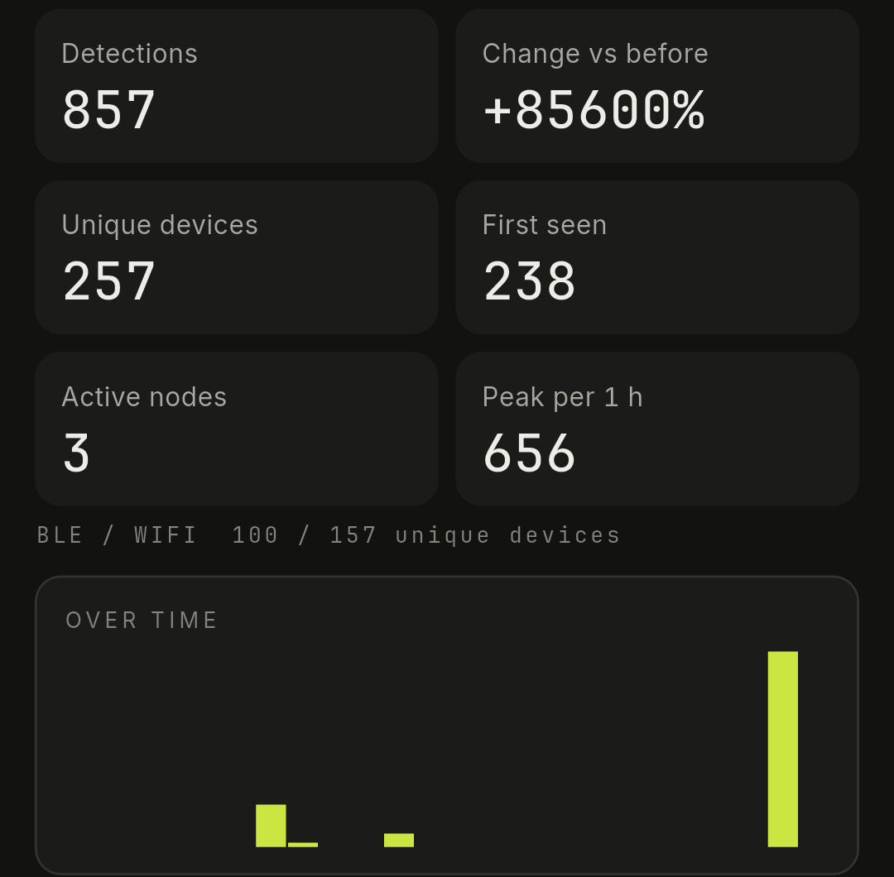
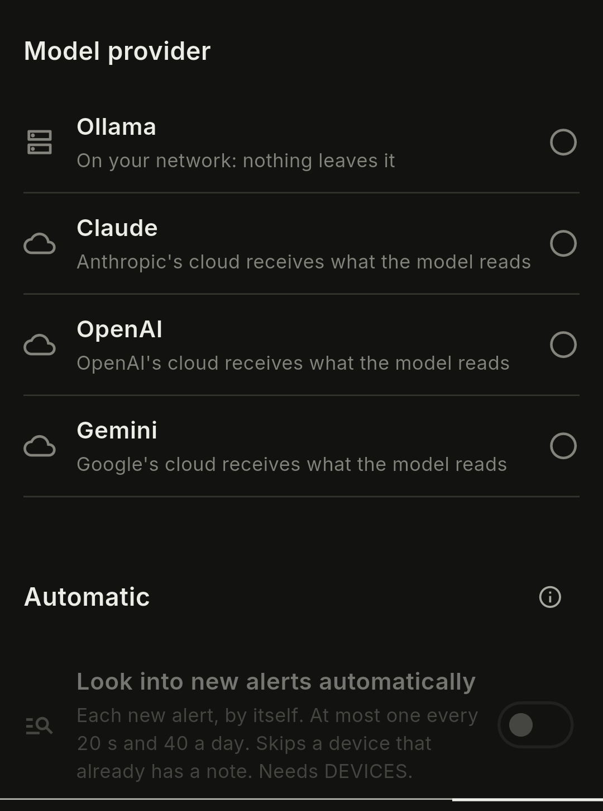
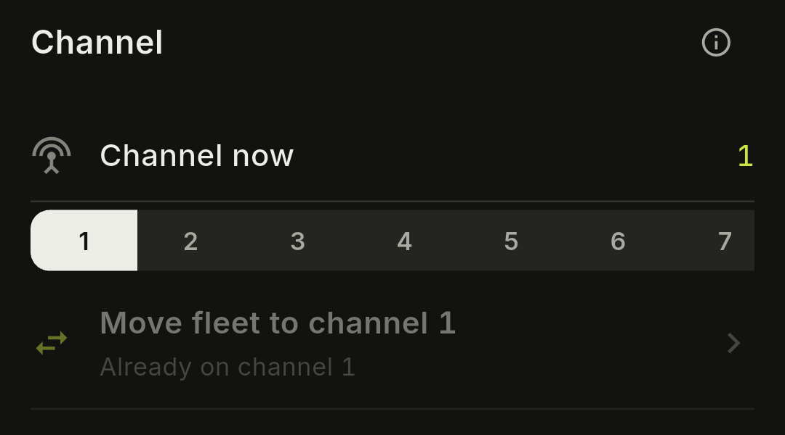
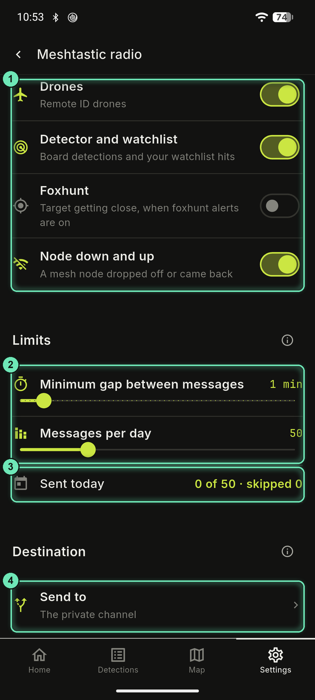

# OUI-APEX v0.7.0

App 0.7.0, firmware 0.7.0. This release brings over the features of the OUI SPY Recon app, adds an FPV receiver for the XIAO ESP32-C5, and makes the mesh sturdier. Update the boards and the app together.

## New

- **FPV receiver (XIAO ESP32-C5):** finds analog 5.8 GHz FPV video transmitters on 44 of the 48 standard channels. **SCAN** stops on the strongest transmitter, **SWEEP** keeps the channel grid live and **HOP** visits flagged channels. A proximity gauge swings from FAR to CLOSE as you get nearer. A transmitter only lights its own channel: neighbors within 19 MHz that pick up its bleed stay dark. Flagged transmitters show up in the Drones list under the **FPV** chip. Receive only, no picture.
- **Drones:** a page per drone with a saved name, tag and notes, a 90-day report log with CSV and KML export, a **Remote ID** or **FPV** filter, and **Follow** on the map.
- **Alerts:** alert zones on the map, re-arm after a quiet period, alerts when a node goes down or comes back, and **Silence all**.
- **Search:** one search box across detections, drones, alerts and nodes, with counts that wrap on narrow screens.
- **Devices:** name, group and notes on any device, a single-device export, and **Alert when a board hears it**, which adds the device to the boards' watchlist and can be undone.
- **Map:** pins, a measure tool, offline map areas (OpenFreeMap and USGS), and triangulation of a device heard by three placed nodes (off by default).
- **Assistant:** a language model (Ollama, Claude, OpenAI or Gemini) can read what the app has seen and act within grants you switch on. Automatic alert lookups and scheduled reports are both off by default.
- **Meshtastic radio:** pair the phone's own Meshtastic radio over Bluetooth, pick a private channel, and send a message or your position by LoRa. It has its own page, SETTINGS → DATA → **Meshtastic radio**, with automatic alerts: off by default, per-type toggles, a minimum gap, a daily cap and a choice of channel or nodes. The app reconnects to the saved radio at start and every 15 s after the link drops. Radios with a Bluetooth PIN pair from the app.
- **Home dashboard link:** connect the app to `tools/home-dashboard` and manage its connectors, including the dashboard's Meshtastic radio.
- **ATAK:** catches and Remote ID drones as CoT map markers over UDP.
- **Probe intel**, a **rule builder** with node presets, and the **AXEOFF** and **BLE Sniff** engines.
- **Database:** SETTINGS → DATA → Capture Database → **Backup, restore or delete** saves the phone's database to a file, loads one back, or erases it after a warning.
- **Signed self-update** for the app, and **firmware over the mesh**: pick nodes and send each one a build.

<table>
  <tr>
    <td width="50%" valign="top"> <b>Fleet metrics</b></td>
    <td width="50%" valign="top"> <b>Assistant</b> settings</td>
  </tr>
  <tr>
    <td width="50%" valign="top"> Mesh <b>Channel</b></td>
    <td width="50%" valign="top"> <b>Meshtastic radio</b> automatic alerts</td>
  </tr>
</table>

## Mesh

- **Channel move:** move the whole mesh to channel 1 to 11 from the app. The manager asks every node to confirm, then all switch together. A node that misses the move finds the fleet again on its own.
- **Fleet control:** identify, read or reboot every node, and see each node's build, filters, uptime, peers and temperature.
- **Fleet metrics:** detections, wardrive and drone views per hour, day, week or month, for all nodes or one.
- **Signal:** how strongly each node hears the others, one row per direction.
- **Delivery:** nodes send wardrive batches straight to the manager instead of broadcasting them, so far fewer records are lost.

## Pairing

- Boards pair with a PIN. The Connect screen shows the default PIN, 123456, next to a board that still uses it, and the app asks you to set your own after the first pairing.
- Re-pairing after **Forget** works on the first try.

## Fixes

- XIAO ESP32-C5: out-of-memory errors on ESP-NOW, a lockup when the mesh channel changed, and the FPV task running while unused.
- Stat tiles and count strips wrap instead of cutting off their labels, and the Detections counts fill the row.
- The channel chart on Capture Database no longer overflows with large text.
- The Meshtastic radio list shows only Meshtastic radios.
- Explanations on settings pages moved behind ⓘ buttons.
