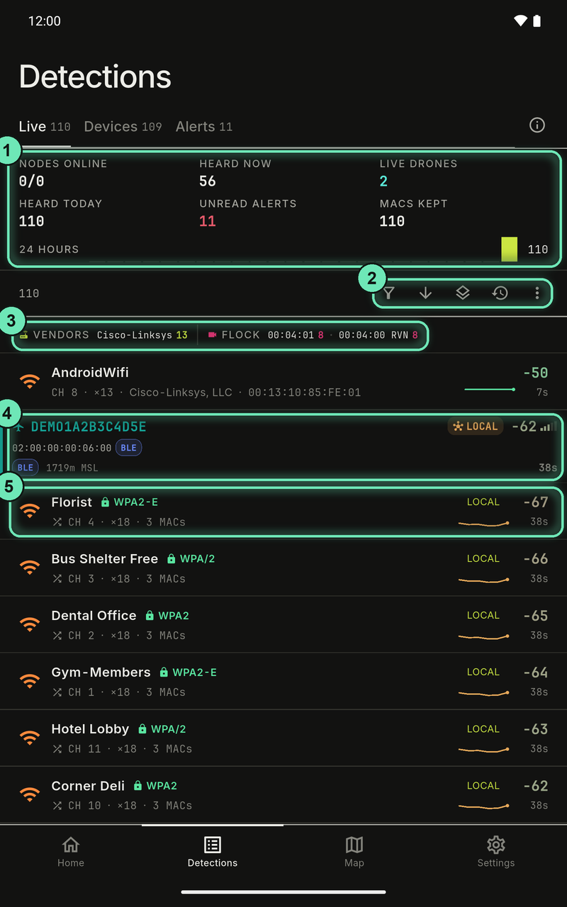
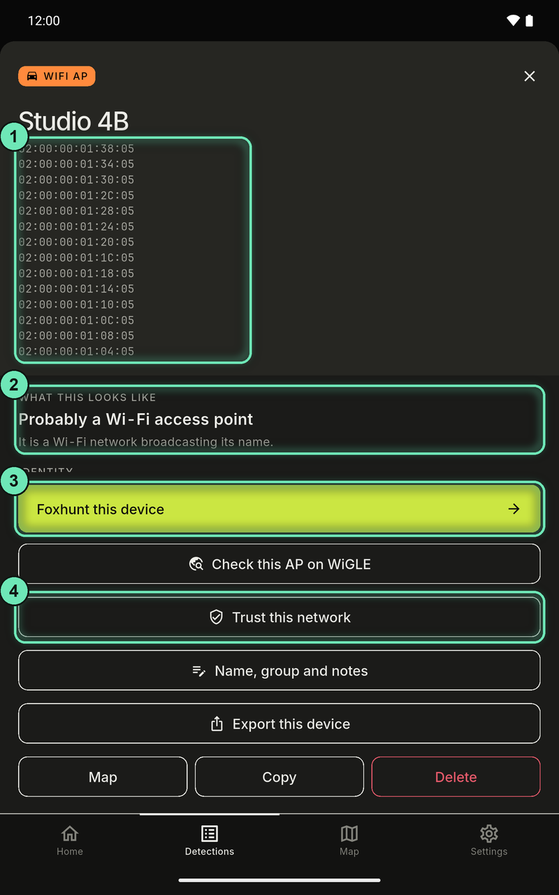
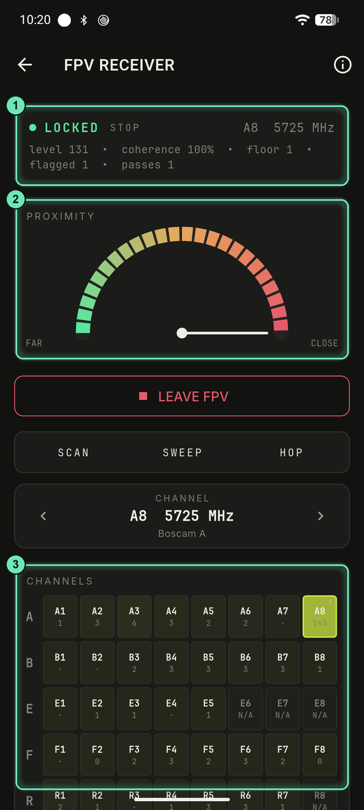

# OUI-APEX v0.7.0

There's a lot in this one: 412 commits since v0.6.1 came out on October 3. The app and the firmware are both version 0.7.0.

Here's what changed the most:

- Your phone can scan by itself now, with no board. See [Your phone scans on its own](#your-phone-scans-on-its-own).
- On Android, you can plug a USB Wi-Fi adapter or an RTL-SDR dongle straight into the phone. See [USB radios on Android](#usb-radios-on-android).
- Every device the app hears gets a class, such as tracker, camera or drone, and you pick which classes alert you. See [Detections and devices](#detections-and-devices).
- The XIAO ESP32-C5 can find analog FPV video transmitters. See [FPV receiver](#fpv-receiver-xiao-esp32-c5).
- You can move a whole mesh of boards to another channel from the app. See [Mesh](#mesh).
- Boards ask for a PIN when you pair, and they only install signed firmware. See [Boards and firmware](#boards-and-firmware).

Update your boards when you install this app. PIN pairing, the mesh channel move and the FPV receiver all need the 0.7.0 firmware. You can update from the app under SETTINGS → Node → **Firmware**, or with the [web flasher](https://lukeswitz.github.io/oui-spy-unified-blue/).

## Contents

- [The new app layout](#the-new-app-layout)
- [Your phone scans on its own](#your-phone-scans-on-its-own)
- [USB radios on Android](#usb-radios-on-android)
- [Detections and devices](#detections-and-devices)
- [Alerts and watches](#alerts-and-watches)
- [Watchlists and signatures](#watchlists-and-signatures)
- [Map](#map)
- [Wardriving and sessions](#wardriving-and-sessions)
- [Drones](#drones)
- [Mesh](#mesh)
- [Boards and firmware](#boards-and-firmware)
- [Meshtastic, ATAK, home dashboard and assistant](#meshtastic-atak-home-dashboard-and-assistant)
- [Privacy](#privacy)
- [Fixes](#fixes)

## The new app layout

The app is called OUI-APEX now, and every screen was rebuilt. There are four tabs at the bottom: **Home**, **Detections**, **Map** and **Settings**. Detections has four views of its own: **Live**, **Devices**, **History** and **Alerts**.

Settings is split into **App**, **Scanning**, **Detection & Alerts**, **Node**, **Data** and **About**, and each one opens into its own pages. You can pick one of ten color themes under SETTINGS → App → **Theme**.

The first time you open the app, it asks for each permission on its own screen. On Android it also asks for location all the time, which Android needs to keep scanning while the screen is off.

A few smaller things you'll notice:

- Most screens and section headers have an ⓘ button that explains what's on them.
- If your board can't use a control, the control stays on screen, dimmed, with the reason. For example, a board without a buzzer says "This board has no buzzer."
- The search box on Live searches devices, alerts, drones, nodes and wardrive rows all at once.
- A strip above Live counts the nodes online, the devices you're hearing right now, live drones and unread alerts.
- SETTINGS → About now lists the open-source licenses.

## Your phone scans on its own

You don't need a board to get started anymore. Tap **USE THIS DEVICE** on Home and the phone scans with its own radios. It uses Bluetooth on Android, iPhone and Mac, and Android scans Wi-Fi too. Whatever the phone hears shows up under the node name **PHONE**.

With no board connected, **Foxhunt this device** uses the phone's own Bluetooth to lead you to the signal.

On Android, the phone also picks up drone Remote ID. It reads it from Bluetooth, from Wi-Fi beacons, and from Wi-Fi Aware on Android 13 and later.

iOS hides the maker data of nearby Apple devices, so the app lists them as *Possibly Apple, hidden by iOS*. It then connects to each one for a moment to tell an AirTag from AirPods or an Apple Watch. It never does this to your own boards.

## USB radios on Android

On Android you can now plug a USB Wi-Fi adapter or an RTL-SDR dongle into the phone. The app drives it directly, with no root and no custom kernel. Once it's plugged in, it shows up on Home and under SETTINGS → Scanning → **External Adapters**.

### Wi-Fi adapters

These chips work: MediaTek MT7921AU and MT7612U, Realtek RTL8812AU, RTL8814AU, RTL8811AU and RTL8821AU, Atheros AR9271, and Ralink RT3070. The MT7921AU scans Bluetooth LE as well.

Adapters only listen. They run in monitor mode and never transmit. They start when you tap START, and they stop when the session ends.

You can run several adapters at once. Each one gets its own switch on Home and shows up as its own node, and they split the channel list between them. Wi-Fi clients they hear are listed under the network they're using.

To change how often the adapters and boards sweep every channel, use SETTINGS → Scanning → Timing & Re-log → **Full WiFi sweep every**.

You can also connect a board to the phone with a USB cable and link over that instead of Bluetooth.

### RTL-SDR

Plug in an RTL2832U dongle and open the SDR screen. It has three modes: **Spectrum**, **ADS-B** and **SCAN**.

<ol>
  <li><b>Bands</b>: pick 315, 433 or 915 MHz, or several to sweep them, then tap START.</li>
  <li><b>Types</b>: tap a chip to turn that type on or off. Each chip counts what it found.</li>
  <li><b>Decoded devices</b>: newest first. Tap one for its details and to foxhunt it.</li>
</ol>

SCAN decodes about 380 kinds of devices with decoders from the rtl_433 project. That covers weather stations, utility meters, security sensors, remotes and key fobs, home sensors and tire-pressure sensors. Decoders that can't check a checksum are off, the same as in rtl_433, so random noise doesn't turn into fake devices.

Wireless M-Bus meters decode too. For Itron and Silver Spring smart-meter networks, the app shows which meter talks to which.

ADS-B lists the aircraft around you with their operator, type, registration and a photo, and it draws each flight path on the map. One button uploads them to WDGWars.

Everything the SDR decodes is saved to History under an **SDR** filter, along with your GPS position. You can foxhunt any of it by signal strength.

## Detections and devices

Every device the app hears now gets a class, such as tracker, camera or drone. The classifier is based on offgridpete's Fieldwatch device catalog.

The classes are finder tags, beacons, signage, wearables, surveillance, drones, pentest tools, public safety, vehicles, glasses, audio, cameras, thermostats, access control, health, home IoT, ISP and routers, mesh radios, phones and PCs, adult toys, and 802.15.4 devices.

The new **Devices** view groups everything by class. You can collapse a section, or drag the sections into the order you want.

<ol>
  <li><b>Tools</b>: filter, sort, group by type, and group Wi-Fi clients under their network.</li>
  <li><b>A device type</b>: tap to open it. The handle arranges the sections.</li>
  <li><b>A camera you drove past</b>: its line shows the signal getting stronger, then weaker.</li>
  <li><b>With you</b>: the walking icon marks a device that moves with you, such as your own earbuds.</li>
</ol>

The app recognizes a lot more than before:

- Ring, Nest, Arlo, Hikvision and other security cameras, plus Amazon Sidewalk devices.
- Axon gear, by its Bluetooth services.
- Google Find Hub trackers, and every Tile.
- Ten more DJI vendor prefixes.
- Samsung SmartTags. A tag away from its owner keeps its track even when its address changes.
- Google Fast Pair devices in pairing mode, which now show their model name.
- Device makers, from the full IEEE vendor database that's now built in.

**Live** now shows one row per network name. Open a row to see every MAC address behind that name. Small icons mark a random MAC, a hidden network, and a device that's moving with you.

<ol>
  <li><b>Tools</b>: filter, sort, group Wi-Fi clients under their network, open HISTORY, and more.</li>
  <li><b>Top vendors and Flock</b>: tap a vendor to show only its devices.</li>
  <li><b>A drone</b>: its Remote ID, the radio that heard it, and its altitude.</li>
  <li><b>A detector hit</b>: here a camera, with its channel and hit count.</li>
  <li><b>A Flock hit</b>: with its confidence.</li>
</ol>

You can sort by name, vendor, class, first seen or signal. If you tap a vendor in the strip at the top, that vendor's devices move to the top.

**History** now keeps every hit and every alert. To search everything you've ever stored, including imports, use SETTINGS → Detection & Alerts → Your Lists → **Search all captures**.

Tap any device to open its details. The sheet starts with **WHAT THIS LOOKS LIKE**, the app's best guess in plain words. Under that you'll find its identity, signal, decoded advertisement, services, and when it was first and last seen. A Flock hit says "Flock Safety device" and how it matched.

<ol>
  <li><b>What this looks like</b>: the app's best guess, in plain words.</li>
  <li><b>Foxhunt this device</b>: follow its signal to the source.</li>
  <li><b>Trust this network</b>: warns you later about lookalikes.</li>
</ol>

From the details you can also:

- Give the device your own name, a group and notes.
- Export every sighting of it as CSV, JSON, KML or KMZ.
- Make a tracker ring. Tap **Make it play a sound**, and the board connects to the tracker and asks it to play its sound.

## Alerts and watches

All your alerts now land in one place, the **Alerts** view, newest first. You choose which device classes alert you in SETTINGS → Detection & Alerts → **What to Watch For**. The **Alert threshold** there, **All**, **High+** or **Verified**, sets how sure a detector hit has to be before it alerts you.

<ol>
  <li><b>An alert</b>: what was found, why, and when. Tap it for the map and the device.</li>
  <li><b>Count and clear</b>: how many alerts, and a button to clear them.</li>
</ol>

New watches look for patterns instead of single devices:

- **Seen at your stops** (History → More) lists radios heard at 2 or more of the places you stopped in the last 7 days.
- **Trusted networks**: tap **Trust this network** on your own Wi-Fi, and the app warns you if a lookalike shows up.
- On Android, **Cell network watch** warns you when the phone drops to 2G or 3G, or when a new tower appears at a place you know. **GPS spoofing & jamming** warns you about faked GPS.
- Movement alerts tell you when a drone is loitering near you, an aircraft is circling you, a car seems to be following you, or a device is moving across your mesh. The car alert works from tire sensors, so it needs an RTL-SDR.
- Boards now catch Wi-Fi beacon floods, where one radio fakes a crowd of networks, and deauth attacks, counted per sender. A beacon flood you only hear for a moment while driving is ignored.
- Draw an alert zone with the fence button on the map. **In your zone** then alerts you when a drone or device is inside it.

You can also compose your own alert melodies and give each alert type its own. They're in SETTINGS → Detection & Alerts → Notifications → **Alert sounds**. You can preview a melody on the board, and a manager passes it on to its nodes.

A few settings control how often you're alerted:

- **Repeat for a device** alerts you again about a device that has been quiet for 60 seconds.
- **Max per minute** caps how many alerts you get.
- **Re-log time**, from 1 to 60 seconds, sets how soon the same device gets logged again.

If a mesh node goes quiet for 45 seconds, you get a **Node down** alert, and a **Node back** alert when it returns. **Silence all** mutes every sound and notification until you turn it off, and the alerts still get logged.

On iPhone, live counts and the latest alert show on the Lock Screen, in the Dynamic Island, and in CarPlay on iOS 26. Android shows the same thing in an ongoing notification.

## Watchlists and signatures

You can now write your own detection rules, push ready-made sets to your nodes, and turn groups of unknown radios into signatures.

- **Add a rule** matches a device name, text in a Bluetooth name or its start, a Bluetooth name pattern, company data, a full MAC address, or a Wi-Fi probe or beacon address prefix.
- **Presets** are ten ready-made sets: Axon, Meta glasses, i-PRO, Verkada, Trackers, Drones, Vehicles, Wearables, Flipper and Police. Tap one, then **WATCH ON PHONE** or **INSTALL ON NODES**.
- Through a manager, you can open one node's filters to see and edit its rules. When you send a watchlist, each node tells you whether it took it, and why not if it didn't.
- Watchlists import from JSON or CSV, up to 5,000 rows, and export as JSON.
- Tap **Alert when a board hears it** on any device to add it to every board's watchlist. **UNDO** takes it back.
- Under Devices → More, **Suggested signatures** groups three or more unknown radios that share a name, service, vendor prefix or company. **Save signature** turns a group into your own signature, with an alert when new ones show up.
- **Signature sets** (SETTINGS → Detection & Alerts → Your Lists) adds the Fieldwatch stock catalog, Home Assistant's Bluetooth device list, or your own set from an https link or a file.
- Detector targets, their labels and signatures now survive a board reboot.

## Map

The map picked up pins, a ruler, offline areas and triangulation.

<ol>
  <li><b>Session</b>: time recording, and counts of Wi-Fi, Flock, drone, detector and BLE hits.</li>
  <li><b>Flock list</b>: tap the chip to open or close it. Tap a row to zoom the map to it. Drones and detector hits have their own lists.</li>
  <li><b>Drive</b>: distance, speed, hits per km, and Stop / Pause.</li>
</ol>

- Drop a pin and give it a name. You can rename or remove it later.
- Tap the ruler, **Measure a distance**, then tap points on the map.
- **Save map area** downloads what's on screen for offline use, up to 3,000 tiles or 50 MB. It works with the OpenFreeMap styles and the USGS US satellite map.
- There are 13 map styles, and none of them needs an API key.
- **Triangulation** estimates where a device is from 3 or more mesh nodes. It's off by default. To set it up, stand at each node and tap **Place at my position**.
- **SHOW ALL** puts every detection of one class on the map.
- Tap a cluster to list what's in it, or tap an alert pin to open the alert.
- If the board drops during a wardrive, a banner counts down from 5 minutes. Reconnect before it runs out and the session keeps going.
- If you start a session inside a quiet zone, the radios stay off.
- The map lists every live mesh node.

## Wardriving and sessions

Every saved session now has a **Wardrive Report**. It shows the route, new and known networks, Flock cameras, drones and watchlist hits, and you can share it as text.

<ol>
  <li><b>Totals</b>: Wi-Fi networks, how many were new, and Bluetooth devices.</li>
  <li><b>Wi-Fi networks</b>: new, seen before, hidden, and per band.</li>
</ol>

- Sessions now keep every hit and alert, the GPS track and altitude. Anything heard before the first GPS fix gets that first fix.
- The wardrive target that used to be called WiGLE is now **SCAN**. It records every Wi-Fi and BLE device.
- You can start a wardrive from Home before the phone has a GPS fix.
- If the board drops and the session doesn't need it, the phone and USB adapters keep recording.
- Wardriving boards now report Wi-Fi clients, take a network's channel from its beacon, and learn hidden network names from probe responses.
- WiGLE CSV files now follow WiGLE's format, with altitude, Bluetooth rows and WPA3 security types. A session that's already on WiGLE won't upload twice. **Donate data to WiGLE** is off by default.
- WDGWars uploads now tell you how many networks were imported, how many were new, and how many were merged.
- SETTINGS → Data → Capture Database → **Backup, restore or delete** saves your database to a file, loads one back, or erases it.

## Drones

Drones get their own list and their own page now.

- Filter the **Drones** list by **Remote ID** or **FPV**. The app remembers which one you picked.
- On a drone's page you can tag it, give it a name, group and notes, look through its past flights, and tap **Follow** to keep it centered on the map.
- Remote ID reports are kept for 90 days. **Export logs** saves them as CSV or KML.
- Remote ID details now show the maker, worked out from the serial number, plus height above ground and the operator's position and altitude.

### FPV receiver (XIAO ESP32-C5)

A XIAO ESP32-C5 can now find analog 5.8 GHz FPV video transmitters, on 44 of the 48 standard channels. It only listens, and it doesn't show the video. Open it from the **FPV receiver** tile on Home.

<ol>
  <li><b>Status</b>: LOCKED, TUNED or the running mode, the channel, its level, coherence and noise floor, and how many channels are flagged.</li>
  <li><b>Proximity</b>: the needle moves toward CLOSE as the tuned channel rises above the floor.</li>
  <li><b>Channels</b>: brighter is stronger, a bolt marks a flagged transmitter, and tapping a cell holds that channel.</li>
</ol>

- **SCAN** stops on the strongest transmitter, **SWEEP** keeps the whole grid live, and **HOP** cycles through the flagged channels.
- A transmitter also leaks onto nearby channels. Only its strongest channel gets flagged.
- Flagged transmitters show up in the Drones list under **FPV**.
- FPV isn't available on the T-Dongle-C5 or on a manager.

## Mesh

You can now move the whole mesh to another channel from the app. Go to SETTINGS → Node → Mesh → **Channel** and pick a channel from 1 to 11. The manager asks every node to confirm, and then they all switch at once. A node that misses the move finds the fleet again by itself.

<ol>
  <li><b>Channel ⓘ</b>: how a move works.</li>
  <li><b>Channel now</b>: the mesh's current channel.</li>
  <li><b>Picker</b>: the channel to move to, 1 to 11.</li>
  <li><b>Move fleet</b>: asks every node to confirm, then all switch together.</li>
</ol>

- **Fleet control** has **Identify all**, **Read all** and **Reboot all nodes**. It shows each node's build, filters, uptime, peers and temperature.
- **Signal** shows how strongly each node hears every other node, one row per direction.
- You can update node firmware over the mesh, with no Wi-Fi. Pick the nodes, and they update one at a time.
- The Mesh page now shows the board's actual mode, broadcast or encrypted. Before, it showed the app's default.
- Nodes now send wardrive batches straight to the manager instead of broadcasting them.
- The XIAO ESP32-C5 can run as a manager.

**Fleet metrics** charts the last hour, day, week or month, for all nodes or for one node. It has three views: **Detections**, **Wardrive** and **Drones**.

<ol>
  <li><b>Totals</b>: detections, change against the span before, unique and new devices, active nodes and the busiest period.</li>
  <li><b>BLE / Wi-Fi</b>: unique devices on each radio.</li>
  <li><b>Over time</b>: detections per period in the chosen span.</li>
</ol>

## Boards and firmware

Boards now ask for a PIN when you pair, and they only install firmware signed with the release key.

- A new board's PIN is 123456. The app asks you to change it after you pair. You can change it later under SETTINGS → Node → Firmware → **Bluetooth PIN**.
- A board only accepts a new phone for 2 minutes after it powers on.
- Your phone stays paired when the board reboots, and pairing again after **Forget** works the first time.
- If a new firmware image doesn't keep running for 60 seconds, the board goes back to the old one.
- Boards advertise as OUI-SPY-S3, OUI-SPY-C5, OUI-SPY-C3 or OUI-SPY-32. Until you rename one, the app names it by its chip, such as OUISPY-C501. To rename a board, tap the pencil next to it on the Connect screen.
- There are two new engines. **AXEOFF** is a passive Axon detector that only beeps. **BLE Sniff** captures every Bluetooth advertisement to a file Wireshark can open.
- C5 boards can now scan **802.15.4 (Zigbee, Thread)** while wardriving, and capture it to PCAP, on channels 11 to 26. A manager shows the switch when a C5 node is in its mesh.
- **JCMK Node Hub** (SETTINGS → Node) turns a board into a hub that collects networks from Piglet and JCMK ESP-NOW wardriver nodes.
- T-Dongle and M5Stick boards have a new detections screen that shows the 4 latest hits.
- An engine you start with the board's own button keeps running when the phone disconnects.
- SETTINGS → Node → Flock Detection → **Report OUI-only WiFi hits** reports a Wi-Fi device on its maker prefix alone. It's off by default, and it gives more false positives.
- Foxhunt now works on law enforcement devices too.
- Switching passive Bluetooth on or off takes effect right away, without a reboot.
- The M5StickC PLUS no longer joins the mesh. Like the other M5Stick boards, it doesn't have the memory for it.

## Meshtastic, ATAK, home dashboard and assistant

The app can now send alerts out over Meshtastic and ATAK, link to a dashboard on your computer, and let a language model look at what it has found.

### Meshtastic radio

Pair your own Meshtastic radio under SETTINGS → Data → **Meshtastic radio**. Then you can send a message or your position by LoRa on a private channel.

<ol>
  <li><b>This phone's radio</b>: link state and the paired radio's name.</li>
  <li><b>Connect</b>: links to the paired radio. Close the Meshtastic app first.</li>
  <li><b>Change radio / Forget this radio</b>: pick another radio or drop this one.</li>
  <li><b>Send alerts automatically</b>: off until you turn it on and confirm.</li>
</ol>

If you turn on **Send alerts automatically**, you choose which alert types go out. By default the app waits at least 60 seconds between messages and sends no more than 50 a day. It only ever sends on a private channel, never the public one, and it reconnects to your radio by itself.

### ATAK

SETTINGS → Data → Export → **Send to ATAK** sends catches and Remote ID drones to ATAK as map markers over UDP. It's off by default.

### Home dashboard

`tools/home-dashboard` is a web page that runs on your computer and shows the mesh from a board plugged in over USB. You link the app to it under SETTINGS → Data → Export → **Home dashboard**, which is off by default. The dashboard can pass events on to MQTT, a TAK server, Reticulum and its own Meshtastic radio.

### Assistant

You can let a language model read what the app has found and, if you allow it, change settings. It's off by default. Turn it on under SETTINGS → Data → **Assistant**.

<ol>
  <li><b>Model provider</b>: Ollama on your network, or Claude, OpenAI or Gemini in the cloud.</li>
  <li><b>ⓘ</b>: what the automatic features send and when.</li>
  <li><b>Automatic</b>: alert lookups and scheduled reports. Both are off until you turn them on.</li>
</ol>

Each area the model can read or change, such as devices, drones, location or board control, stays off until you allow it. Every change to a board waits for your OK.

### App updates

SETTINGS → About → **Check for update** looks for a newer release. The app only installs a release signed with the release key. **Check at launch** is off by default.

## Privacy

- **Receive only** (SETTINGS → Detection & Alerts → Privacy) is one switch that stops every scan from transmitting, on your boards, their mesh nodes and the phone.
- Boards now pick a new random Wi-Fi MAC every time they boot, and they use a rotating private Bluetooth address. Your paired phone still recognizes them.
- Android no longer includes the app's data in cloud backups.
- Release builds no longer write to the system log.

## Fixes

- Fixed the phone dropping its board a few seconds after the screen went idle.
- Fixed a board pairing and then falling back to "not connected".
- Fixed connecting stalling while a phone scan was running.
- Fixed Android trying to reconnect many times a second after a failed connect.
- **Cancel**, **Scan** and **Forget** now stop every pending reconnect. Switching boards no longer leaves the old one connected in the background.
- Fixed a paired phone connecting after a firmware update but getting no data.
- Fixed the XIAO ESP32-C5 and T-Dongle-C5 failing to pair, or dropping right away, because they ran out of Bluetooth memory.
- Fixed the C5 locking up when the mesh channel changed.
- Fixed mesh nodes missing manager commands while they scanned Bluetooth.
- Nodes now find a manager that was powered on after them.
- Fixed a manager showing fewer devices than a single node, and tone changes not reaching the nodes.
- Fixed a board rebooting when it received an ignore list.
- The web flasher now restarts the board after flashing.
- Fixed the app freezing for up to 2 seconds when you stopped a USB adapter or the SDR.
- Fixed an RTL8811AU or RTL8821AU finding nothing after STOP and START until you replugged it.
- Fixed Home still showing a USB adapter after you unplugged it.
- Bad Wi-Fi frames from USB adapters no longer show up as networks.
- Fixed BLE Sniff naming the wrong maker for six Bluetooth company IDs. For example, it called Pone Biometrics DJI.
- Fixed the SDR slowing the app down, or hanging on exit, during a scan. The SDR screen now keeps your band choice and shows its frequency labels again.
- WiGLE CSV exports used to leave out Wi-Fi clients, detector hits and rows without a GPS fix. They now include every detection except ones inside an exclusion zone and iPhone hits, which have no MAC address.
- Fixed Silicon Labs radios showing up as a Flock battery, and cut other Flock false positives.
- Fixed the camera alert switch showing off while camera alerts still fired.
- Fixed the bell mute not silencing beacon flood alerts.
- Fixed MAPPED ALPRs always failing, and loading after you'd turned them off.
- Fixed the Add Target dialog crashing when you closed it.
- Stat tiles and count strips now wrap instead of cutting off their labels.
- The scan chips on Home now stay on what you picked after you press START.
